# Recovering Files from APFS Encrypted Volumes: Deleted Files and Lost Partitions

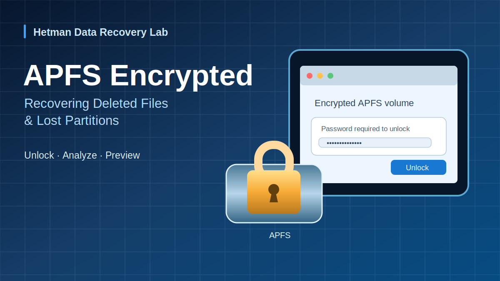

*Cover illustration. Concept art; not an experimental screenshot.*

APFS (Apple File System) supports encrypted volumes that protect file content with cryptographic keys. This protection does not eliminate logical data-loss risks: a user may delete files, remove a volume's partition entry, or reformat a device. Recovery requires both access to the encrypted data using valid credentials and a filesystem analysis capable of locating surviving APFS structures.

This report follows three illustrated workflows involving an APFS Encrypted removable drive: scanning a present encrypted volume, examining a volume after its partition is missing, and searching a physical device for an earlier APFS partition after a filesystem change. The source screenshots document the application's unlock, search and browsing interfaces. They do **not** provide exported-file totals, cryptographic hashes, or independent integrity checks; those outcomes are not inferred below.

## Storage configuration and evidence scope

| Property | Recorded information |
| --- | --- |
| Storage media | Removable USB storage shown in the screenshots; exact manufacturer and model not recorded |
| Original filesystem | APFS with volume encryption (APFS Encrypted) |
| Preparation | APFS (Encrypted) format illustrated in macOS Disk Utility |
| Analysis environment | Hetman Partition Recovery running under Windows in the supplied interface captures; precise Windows build not recorded |
| Authentication | Password-entry dialogs for unlocking the encrypted APFS volume |
| Analysis modes | Existing-volume scan, Full Analysis with APFS selected, and Find Partitions on the physical device |
| Disk geometry | Exact sector size, partition LBAs, APFS container UUID, encryption parameters and acquisition hashes not recorded |
| Data-loss operations | Deleted-file and lost-partition/reformatted-volume cases are described, but the actual destructive operations are not independently captured in the screenshots |
| Verification record | File thumbnails and at least one content preview shown; exported file totals and independent integrity checks not recorded |

## APFS volume encryption and the recovery boundary

APFS organizes storage into containers and volumes. An APFS Encrypted volume requires appropriate authentication before a recovery tool can interpret its plaintext filesystem structures and file contents. The correct volume password allows the application to process encrypted data; knowing the partition location alone is not equivalent to decrypting it.

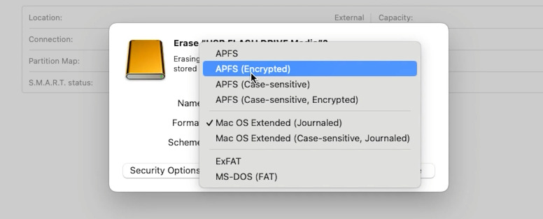

*Figure 1. Disk Utility exposes APFS (Encrypted) as a volume-format option.*

The macOS screenshot establishes the selected encryption-capable format; it does not identify the device's encryption algorithm, key hierarchy or any test password. The distinction between a partition, an APFS container and a volume is especially important when the outer partition map is missing but container or volume metadata may remain on disk.

## Scenario 1 — files deleted from a present encrypted APFS volume

### Detect and unlock the removable volume

The first illustrated path begins with an APFS Encrypted USB volume still represented in the recovery application's disk list. The operator selects it and checks the volume properties before attempting an analysis.

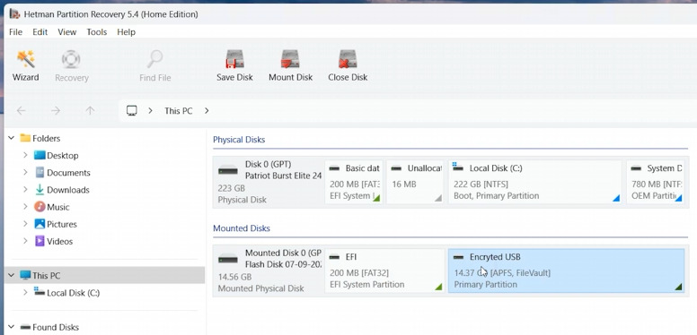

*Figure 2. The removable APFS volume appears in the recovery program's physical and logical disk view.*

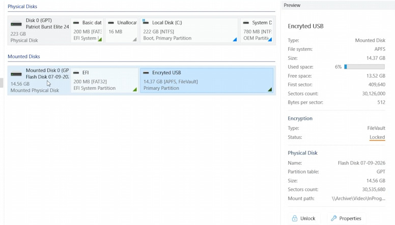

*Figure 3. The volume properties identify the encrypted volume before credentials are provided.*

The application prompts for the existing password. After successful authentication, the analysis can examine the decrypted filesystem rather than treating the encrypted sectors as unstructured data. This is not password cracking or a bypass of APFS encryption.

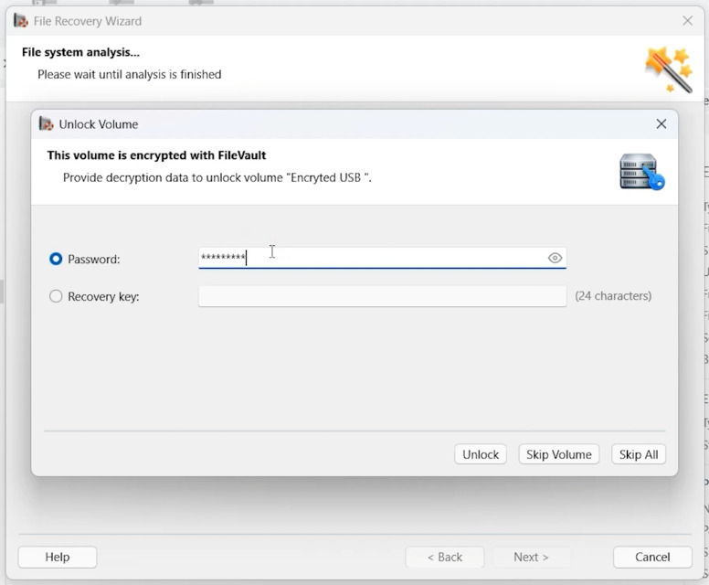

*Figure 4. The application requests the password needed to unlock the encrypted APFS volume.*

### Scan and inspect the result

The next screenshots show an APFS volume in the results view and a set of file thumbnails, including a preview of image content. A visible preview is useful evidence that at least that file content could be decoded in the session. It does **not** establish that every detected entry was completely recoverable or that the content was written to an external destination and verified.

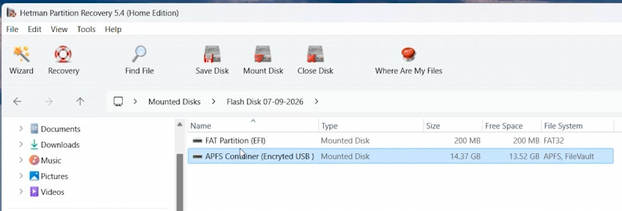

*Figure 5. The unlocked and analyzed APFS volume is listed with its filesystem classification.*

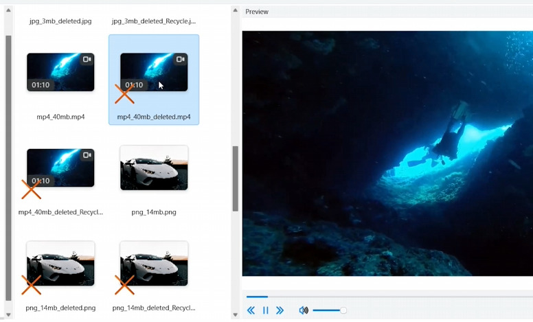

*Figure 6. The scan results include file thumbnails and a preview of an image file; preview demonstrates readable content for that item, not a complete export audit.*

The original instructions advise saving selected files to another physical device. No destination-path screenshot, completed export log, or after-export hash comparison accompanies this sequence.

## Scenario 2 — analysis when the APFS partition is no longer accessible

The second workflow addresses a missing or deleted APFS partition. When the normal volume entry is not available, the document switches to **Full Analysis** of the source device with APFS selected among the target filesystems. A simple existing-volume scan may be insufficient after partition metadata is lost.

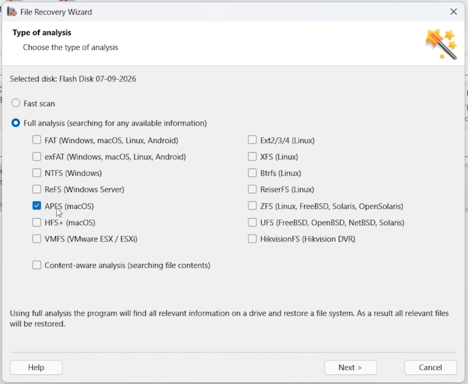

*Figure 7. The full-scan workflow includes APFS in the selection of filesystems to search.*

During the full analysis, a password prompt appears for an encrypted APFS volume. The dialog is evidence of an attempted unlock path while analyzing a discovered encrypted structure. The screenshot does not itself record a finished scan, recovered-file count, or saved-file verification for this separate scenario.

*Figure 8. When an encrypted APFS volume is encountered, analysis requires valid unlock credentials.*

## Scenario 3 — search for a former APFS partition after reformatting

### Search the physical disk

The third workflow describes a device whose filesystem has been changed. The operator selects the **physical device**, rather than scanning only its current logical volume, and uses **Find Partitions** to look for a previous APFS partition. This matters because the current partition table may no longer describe the original APFS container.

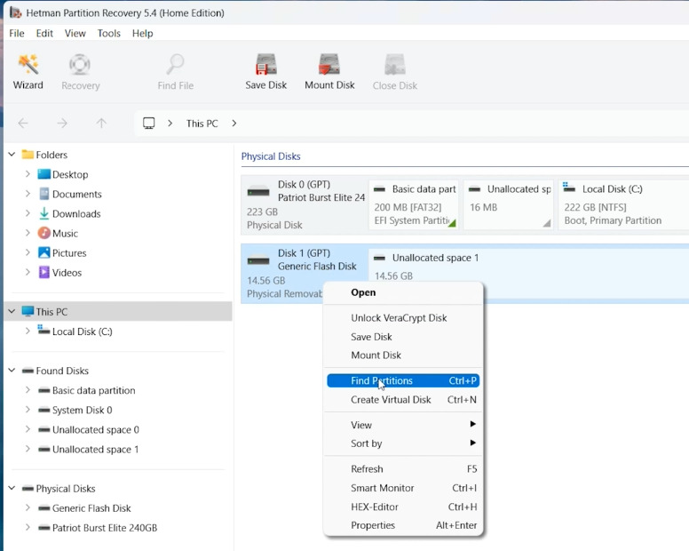

*Figure 9. Find Partitions is launched against the physical disk rather than an existing logical volume.*

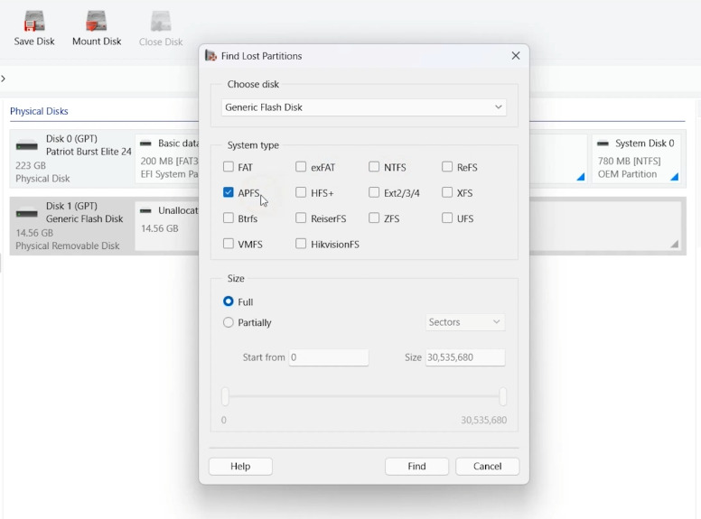

*Figure 10. The partition search is configured to look for evidence of APFS structures.*

The search dialog permits an explicit sector range if an investigator knows reliable start and end boundaries. The supplied material contains no measured LBAs, so no numerical range is invented here; otherwise, the search can use its default device range.

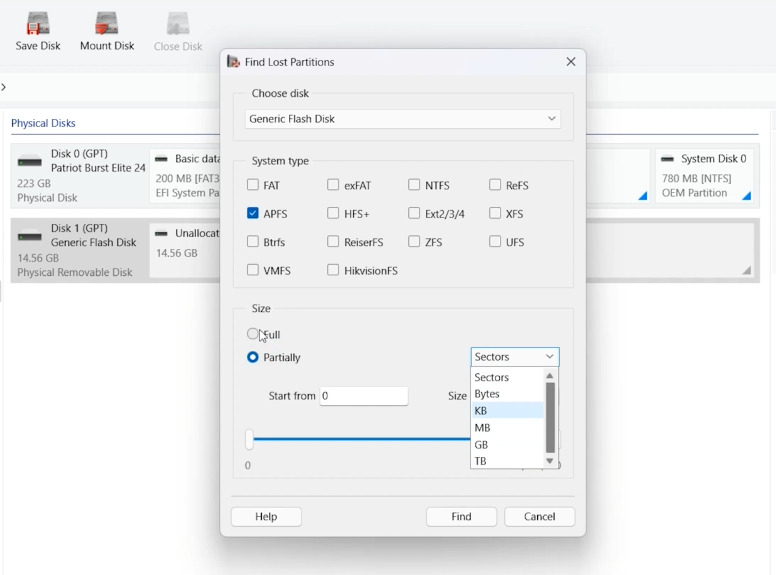

*Figure 11. The search dialog allows the operator to restrict the sector range when verified boundaries are known.*

### Review the partition candidate and encrypted volume

The results interface shows a candidate APFS partition. The disk view later exposes an APFS container and encrypted volume, and a browsing view displays file and folder entries. These images substantiate **partition candidate detection and file-list access**. They do not establish whether any specific item was exported or independently validated after the filesystem change.

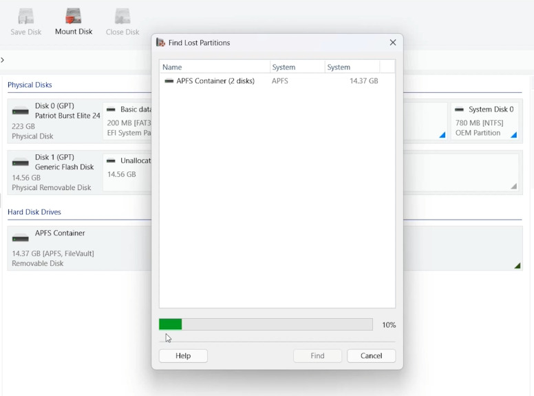

*Figure 12. The search reports a candidate APFS partition; detection is not a file-integrity test.*

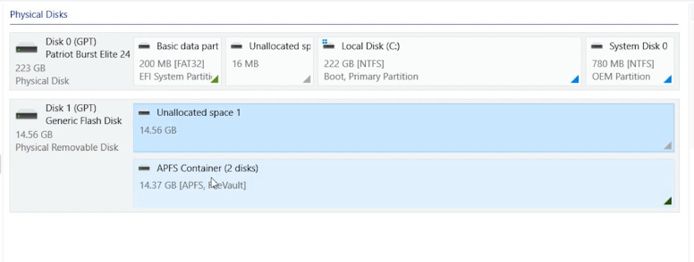

*Figure 13. The program displays the found encrypted volume in the reconstructed partition structure.*

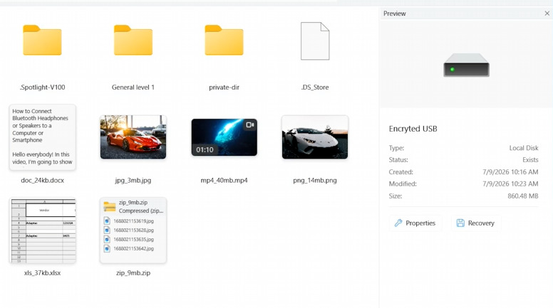

*Figure 14. The result view contains folder and file entries from the found APFS volume.*

## Results and strength of evidence

| Illustrated workflow | Observed in screenshots | Export confirmed | Integrity verified |
| --- | --- | --- | --- |
| Present encrypted APFS volume | Locked/encrypted state, password dialog, browsable results and an image preview | Not recorded | Not recorded |
| Full Analysis of unavailable partition | APFS scan selection and encrypted-volume password dialog | Not recorded | Not recorded |
| Find Partitions after filesystem change | Physical-disk search, candidate APFS partition, encrypted-volume listing and file browser | Not recorded | Not recorded |

The screenshots show interface states rather than a controlled before/after dataset with test-file checksums. Neither the number of detected entries nor a displayed preview should be used as a recovery-success percentage. The source does not provide elapsed scan times, volume offsets or an evidence image with a recorded hash.

## Safety considerations and limitations

- Stop writing to the affected device. Do not reformat it again, run filesystem repair, or save recovered output to the source volume.
- If the source device is unstable, prefer an appropriately acquired sector-level image before repeated scans. The source does not establish that imaging or hardware write blocking was performed in these demonstrations.
- Successful unlocking depends on valid credentials and sufficiently intact encryption metadata. This workflow does not demonstrate recovery without the required password or key.
- SSD TRIM, flash translation-layer garbage collection, subsequent writes and APFS metadata reuse can make deleted content unavailable, even when filenames are still detectable.
- Full Analysis and partition search do not guarantee reconstruction of a reformatted volume. No exact reformat command, filesystem conversion log, partition-sector map, or file-integrity dataset is supplied.
- The illustrated USB-media workflow should not be generalized without further evidence to hardware-bound Mac system volumes, all FileVault configurations, Fusion Drives or all APFS snapshot states.

## Conclusion

The available evidence demonstrates that Hetman Partition Recovery can identify an APFS Encrypted removable volume, present a password-based unlocking workflow, scan APFS structures and display file content for inspection. It also illustrates full-volume and lost-partition search paths where original APFS metadata may no longer be referenced by the current partition map.

The bounded finding is **encrypted-volume recognition, access to a browsable filesystem, preview of at least one file, and candidate partition detection**. Successful bulk export and independent validation of recovered files were **not recorded**, so no broader recovery-rate claim is made.

## Video demonstration

English-language demonstration: https://www.youtube.com/watch?v=bkXcrFO3Wi4

The video is embedded in the [HTML edition of this report](https://hetmansoftware.github.io/data-recovery-lab/experiments/apfs-encrypted-volume-data-recovery/).
