# Recovering Deleted Files from BitLocker-Encrypted Drives: Windows 11, HDD, and USB

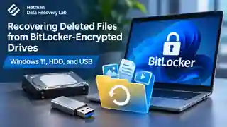

*Cover illustration. BitLocker recovery for three storage scenarios (concept art, not a laboratory screenshot).*

BitLocker encrypts a volume's contents, but it does not prevent accidental deletion, filesystem damage or loss of access to the original Windows installation. Recovering files from such media requires two distinct operations: first, supply valid BitLocker credentials to expose decrypted sectors; second, examine the underlying filesystem for existing or deleted entries. This case study documents the workflows shown for a Windows 11 system volume, a secondary encrypted hard drive and a BitLocker To Go USB flash drive.

The source material illustrates Hetman Partition Recovery unlocking all three types of storage and subsequently displaying files or directories found by its scan. The available evidence is strongest for **unlocking and file detection**, not for a quantified recovery success rate: no per-case file export totals, hash comparisons or independent integrity-validation logs were recorded.

## Test environment and scope

| Property | Recorded configuration |
| --- | --- |
| Software | Hetman Partition Recovery; 5.3 Unlimited Edition appears in the supplied screenshots |
| System-drive scenario | Windows 11 protected by BitLocker; the encrypted drive was attached to another working PC |
| Secondary-HDD scenario | An additional physical HDD with BitLocker-protected NTFS partitions |
| USB scenario | A removable drive protected by BitLocker To Go; one screenshot identifies the protected volume as NTFS |
| Authentication | 48-digit recovery password (system drive); .bek startup-key file (HDD); password (USB) |
| Scan method | Fast Scan after successful BitLocker unlocking |
| Other environments | macOS Sonoma and Ubuntu Linux are mentioned as supported working environments in the source narrative, but their execution is not documented in the supplied scenarios |
| Not recorded | Exact Windows build, software build number, physical sector sizes, precise BitLocker cipher for each volume, device identifiers for every scenario, dataset hashes and elapsed scan times |

The illustrative screenshots show physical devices and selected partitions rather than a reproducible disk image with published checksums. No RAID reconstruction, filesystem repair commands, partition offsets or sector-level measurements are part of this investigation.

## How BitLocker changes a data-recovery workflow

For file-level recovery, BitLocker must be treated as an encryption layer below the filesystem. Supplying a key only exposes the decrypted stream; it does not undelete files or repair NTFS. The recovery program must subsequently interpret valid and damaged filesystem structures.

**Physical device → BitLocker-encrypted volume → valid key or password → decrypted volume sectors → NTFS analysis → file detection, preview and optional export.**

The recovery material can be a 48-digit recovery password, an appropriate password for the protected removable or data volume, or a supported BitLocker startup key stored as a `.bek` file. The Key ID shown by the unlock interface helps match a volume to the right saved recovery password; the Key ID itself is not a decryption key.

> **Technical note:** The document demonstrates authorized unlocking using existing credentials. It does not describe bypassing or breaking BitLocker encryption without a valid key.

## Acquisition and preservation considerations

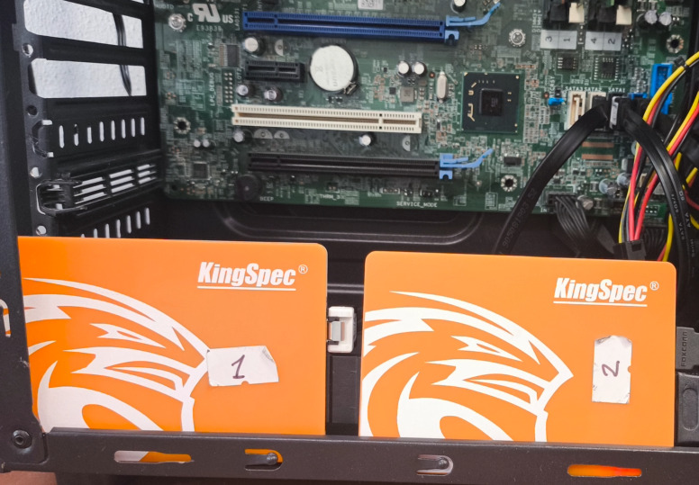

*Figure 1. The source drives were connected to a working PC for analysis.*

The source describes removing a problem disk from the original machine and connecting it to a working PC, preferably using a direct SATA connection or, alternatively, a USB enclosure or dock. The photo documents connected drives, but no write-blocker, drive-image acquisition or read-only hardware configuration is recorded. These safeguards therefore cannot be claimed as steps actually taken in the reported workflow.

- Stop writing to the affected volume and avoid reinstalling Windows, repartitioning, formatting or performing repair operations before preservation.
- If a disk is physically unstable, create a sector-level image with an appropriate tool before extensive scanning, where possible. This is a safety recommendation, not a recorded action from this test.
- Save any subsequently exported data to another physical storage device or a network target, never to the affected disk.

## Scenario 1 — Windows 11 system disk requiring BitLocker recovery

### Observed access problem

The first walkthrough concerns a BitLocker-protected Windows 11 system drive that cannot be unlocked automatically. The source discusses TPM, firmware changes and hardware changes as possible causes of a recovery-key prompt. It does **not** document a specific BIOS update or a controlled TPM modification as the proven cause for the pictured system.

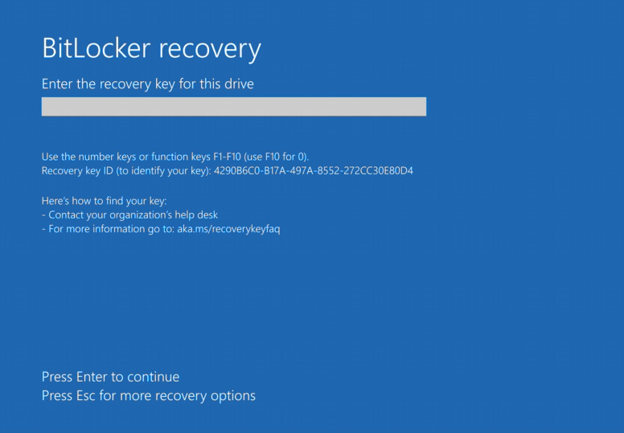

*Figure 2. A BitLocker recovery prompt indicates that automatic system-volume unlocking is unavailable.*

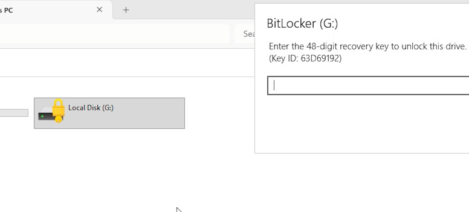

*Figure 3. The encrypted system volume remains locked in the host environment.*

### Unlocking and analysis

The drive is attached to a working PC. In Hetman Partition Recovery, the operator selects the encrypted system volume and opens its built-in BitLocker unlock dialog. The user enters the matching 48-digit recovery password; the Key ID provides a cross-check when more than one key is saved in a Microsoft account or an administrative directory.

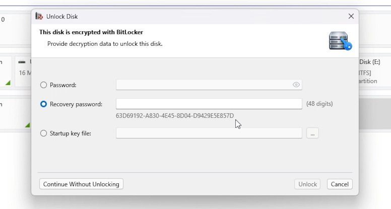

*Figure 4. The application accepts a 48-digit recovery password or an available startup key file and shows the Key ID.*

After the accepted key makes the underlying filesystem accessible, the operator runs Fast Scan. The supplied analysis screenshot and subsequent file list show that file and folder metadata was identified on the decrypted volume.

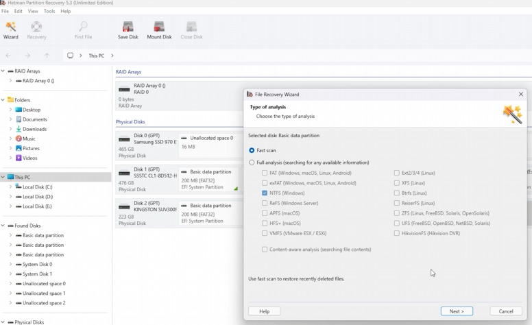

*Figure 5. Fast Scan was selected after the BitLocker volume was unlocked.*

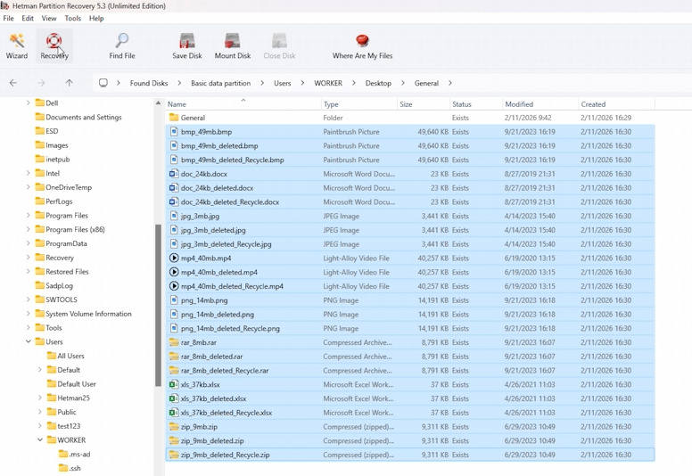

*Figure 6. The scan produced file entries with names, formats and other filesystem metadata.*

The source recommends selecting the needed documents and using Recovery to save them to a separate drive. A recovery/save workflow is illustrated in the source document, but it supplies neither an export log nor independently validated file contents.

## Scenario 2 — secondary BitLocker HDD unlocked with a .bek file

### Scope of the second scenario

The document introduces formatted volumes, damaged partition tables and RAW filesystems as common reasons an encrypted HDD may become inaccessible. The illustrated experiment, however, establishes a narrower observation: an additional HDD containing BitLocker volumes is selected, unlocked with a startup key and scanned. The destructive action, if any, is not recorded in enough detail to identify the precise failure mechanism.

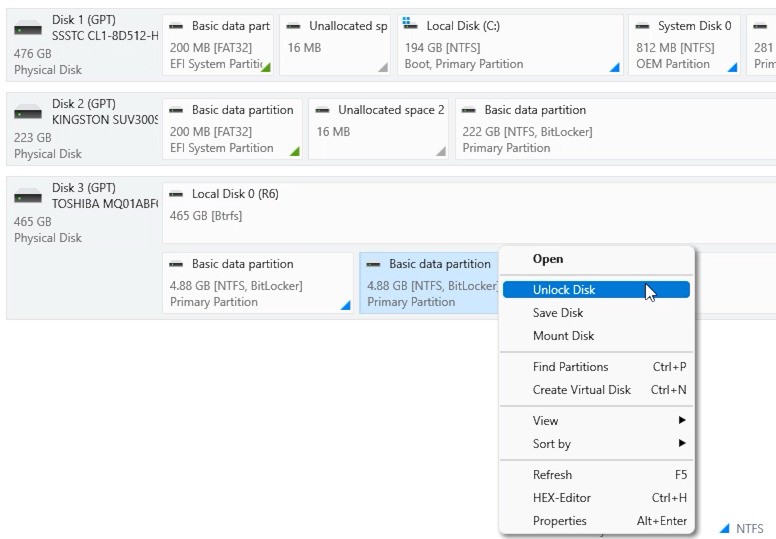

*Figure 7. The second scenario selects an encrypted partition on an additional HDD.*

The application presents an **Unlock Disk** action for the selected partition. Instead of entering a numeric recovery password, the operator chooses **Startup key file** and supplies the saved `.bek` file.

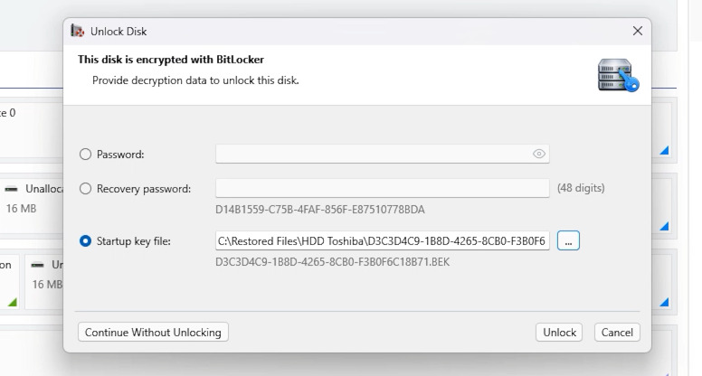

*Figure 8. The secondary HDD was unlocked using an available .bek startup-key file.*

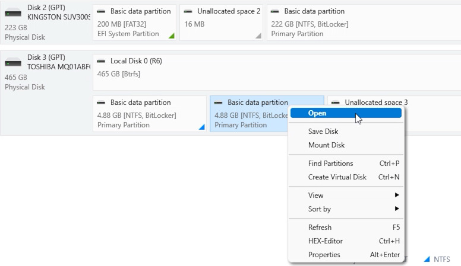

*Figure 9. After authentication the selected partition is available to open for analysis.*

### File-system scan and observed results

After the key is accepted, the partition is opened and a Fast Scan is used to locate file records. The resulting screen displays file entries, including test names marked as deleted. Those labels establish that the scan listed deletion-related entries; they do not by themselves confirm that every referenced file was exported intact.

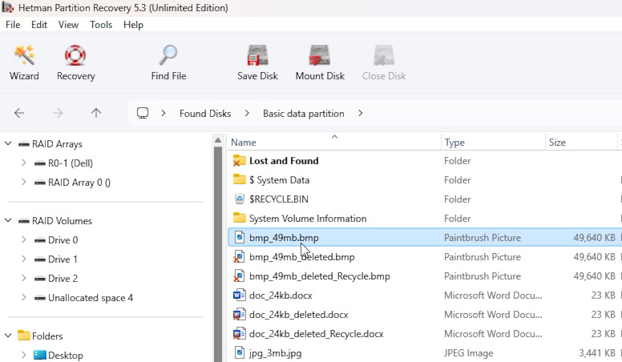

*Figure 10. The program shows file entries, including deletion-labelled test filenames, on the decrypted volume.*

## Scenario 3 — BitLocker To Go USB flash drive

The third walkthrough uses a removable drive protected with BitLocker To Go. Windows shows the USB volume as locked and requests its password. The source also discusses the possibility of RAW status or a format prompt after logical damage, without proving that either occurred in the specific illustrated USB test.

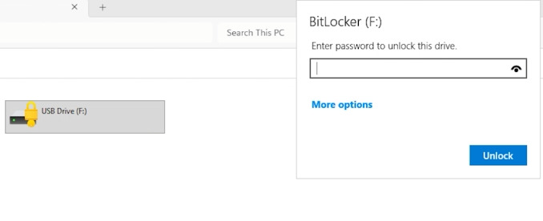

*Figure 11. Windows identifies the removable media as locked and requests a password.*

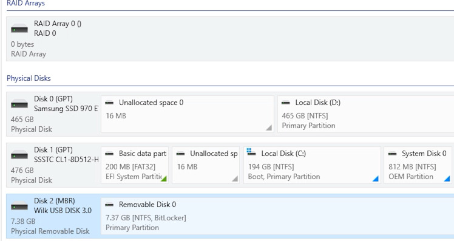

*Figure 12. The software detects the encrypted USB partition before authentication.*

Hetman Partition Recovery recognizes the encrypted removable partition and presents an unlock dialog. The operator chooses **Password**, supplies the existing password, and then runs Fast Scan against the unlocked volume.

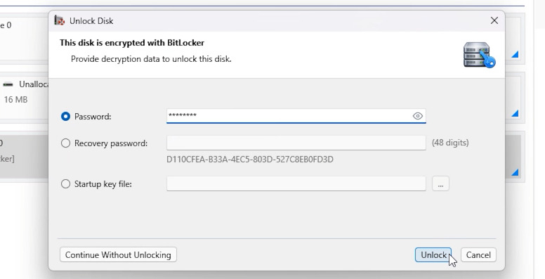

*Figure 13. The USB partition was unlocked with a password entered into the application.*

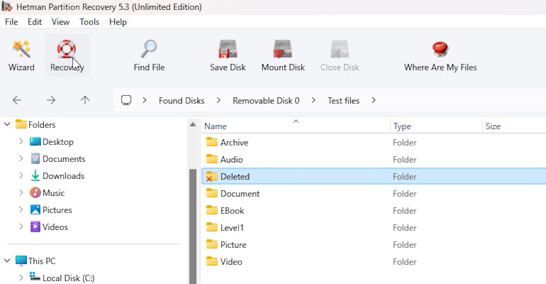

*Figure 14. The unlocked removable volume exposes folders for browsing after Fast Scan.*

The displayed result includes a folder named **Deleted** along with other sample folders. The screenshot demonstrates filesystem browsing after unlocking; it is not proof that every file in this directory was deleted, exported or validated.

## Results and evidence strength

| Scenario | Unlocking | File or folder entries detected | Export recorded | Independent integrity verification |
| --- | --- | --- | --- | --- |
| Windows 11 system volume | 48-digit recovery password, shown | Yes; file list shown after Fast Scan | Not recorded | Not recorded |
| Secondary BitLocker HDD | .bek startup-key file, shown | Yes; entries with deletion-related filenames shown | Not recorded | Not recorded |
| BitLocker To Go USB | Password, shown | Yes; folder list shown after Fast Scan | Not recorded | Not recorded |

The screenshots establish successful progression from an encrypted volume to a browsable file list in all three demonstrations. The supplied report describes preview and recovery operations, but it does not provide measurable file-count totals, before/after checksums, recovered-file application-open tests, or a clear record of which individual files were actually written to a destination.

## Limitations

- The exact trigger for the Windows system-volume recovery prompt and the exact destructive operations performed on the HDD and USB media are not independently documented.
- No per-case encryption algorithm or full-volume BitLocker metadata dump is available; the general description of XTS-AES and compatibility modes is not evidence of which cipher protected each tested device.
- No complete pre-loss file manifest, sector-level disk image, acquisition log or independent recovery validation is included.
- The supplied screenshots show specific examples of NTFS-labelled BitLocker storage. No conclusion about every BitLocker feature, filesystem, platform or damage mode follows from these examples.
- Deleted blocks may have been overwritten or discarded, including by flash storage management; successful unlocking does not restore such content.
- The article does not demonstrate recovery of data without valid BitLocker credentials or recovery from destroyed encryption metadata.

## Conclusion

The three demonstrations establish that supported BitLocker volumes can be recognized and unlocked inside Hetman Partition Recovery with the appropriate recovery password, `.bek` startup key or user password. Following unlocking, Fast Scan identified file and folder entries on the Windows system disk, secondary HDD and BitLocker To Go USB drive. The evidence does **not** establish a numerical recovery rate or independently verified integrity for exported files.

The practical sequence is therefore to preserve the source, locate the correct BitLocker key, unlock the encrypted volume, scan the underlying filesystem, inspect candidate data and export only to another destination. These are distinct stages, and success at an earlier stage does not guarantee success at the next.

## Video demonstration

The matching English-language walkthrough covers the Windows 11 system volume, secondary HDD and BitLocker To Go USB scenarios.

[Watch the English BitLocker recovery demonstration](https://www.youtube.com/watch?v=CbMA34Zr0ak). The [GitHub Pages version of this report](https://hetmansoftware.github.io/data-recovery-lab/experiments/bitlocker-system-hdd-usb-data-recovery/) embeds the player.
