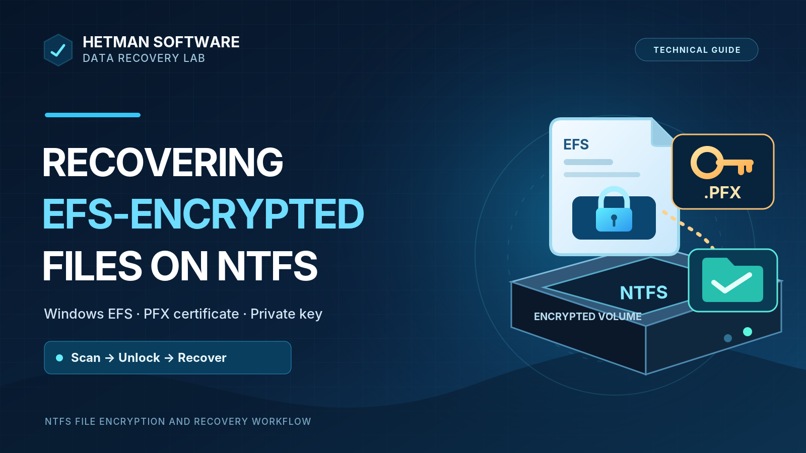

# Recovering EFS-Encrypted Files on NTFS with a PFX Certificate



*Cover illustration. This is explanatory artwork, not an experimental screenshot.*

**Lab:** Hetman Software Data Recovery Lab  
**Case:** `ntfs-efs-encrypted-file-recovery`  
**Test date:** Not recorded in the source script  
**Report status:** Published — workflow documentation (2026-11-12); source script contains no original screenshots

## Research question and scope

How can a data-recovery application locate files encrypted with Windows Encrypting File System (EFS) on an NTFS volume, and what additional information is required to preview and recover their plaintext contents after file loss or loss of access?

The supplied demonstration script describes two complementary workflows: managing the EFS certificate and private key in **Windows**, and examining encrypted NTFS files with **Hetman Partition Recovery on macOS**. It also discusses the software's availability on Windows, Linux, and macOS. The material is a **technical workflow demonstration**, not a controlled multi-scenario benchmark. Hardware specifications, tested software versions, quantitative recovery measurements, and integrity checks were not recorded in the script.

## Test environment and available evidence

| Property | Recorded information |
|---|---|
| Source material | Hetman Software video script, “Відновлення файлів зашифрованих EFS на NTFS диску” |
| File system | NTFS |
| File encryption | Windows Encrypting File System (EFS) |
| Key material | Corresponding EFS certificate and private key, exported as password-protected PKCS #12 (`.pfx`) |
| Certificate-management environment | Windows; exact edition and version not recorded |
| Recovery demonstration environment | macOS; exact version not recorded |
| Recovery application | Hetman Partition Recovery; exact version used in the demonstration not recorded |
| Underlying device, capacity, sector size | Not recorded |
| File count, dataset, checksums | Not recorded |
| Disk-image acquisition and read-only controls | Not documented in the script |

The demonstration discusses deletion, formatting, partition removal, damaged NTFS metadata, and Windows reinstallation as potential causes of loss or inaccessibility. **It does not establish that every one of these failure conditions was separately reproduced and tested.**

## Technical background: EFS versus BitLocker

EFS encrypts **individual files and directories on NTFS**. The protected file remains part of the file-system namespace, but its content requires the appropriate EFS cryptographic key material. A Windows logon password on its own is not a substitute for the matching private key.

| Characteristic | Windows EFS | BitLocker |
|---|---|---|
| Protection scope | Individual NTFS files and folders | Entire volumes |
| Usual authorization material | EFS certificate and corresponding private key | Appropriate volume unlock/recovery credentials, such as a recovery key |
| Main recovery issue | Recover both the file's stored data and the means to decrypt it | Unlock the volume before normal file-system analysis |
| Simultaneous use | Can be layered on an NTFS volume protected with BitLocker | Can protect the volume containing EFS files |

EFS is not supported on FAT32 or exFAT. Conversely, an NTFS file's appearance in a recovery application's directory tree does not mean that its encrypted content can be decrypted. Microsoft's EFS documentation describes it as public-key cryptographic protection for files on NTFS volumes.

## Certificate and private-key handling in Windows

The Windows portion of the demonstration uses the Certificate Manager for the current user:

```text
Win + R → certmgr.msc
Current User → Personal → Certificates
```

Find the certificate associated with **Encrypting File System**. For an exportable certificate that includes the required private key, the script's sequence is:

1. Right-click the certificate and select **All Tasks → Export**.
2. In Certificate Export Wizard, select **Yes, export the private key**.
3. Select **Personal Information Exchange — PKCS #12 (`.PFX`)**.
4. Protect the export with a password and store the file on a separate trusted medium.

A public-only certificate export will not provide the private key required for decryption. Export is possible only when the private key is available and its export policy permits it. Treat a `.pfx` file as highly sensitive: the file plus its password can enable access to EFS-protected content. Do not store the only backup on the affected disk.

If the original Windows installation or user profile is no longer available, possession of encrypted files alone is insufficient. A usable key may still exist in another authorized backup or, in appropriately configured environments, in a recovery-agent setup; none of these alternatives is documented as part of this specific demonstration.

## Data-loss scenarios and preservation

The script identifies the following situations in which EFS-protected content may become unavailable: accidental deletion, formatting, removal of a partition, NTFS damage, and reinstalling Windows without preserving the EFS key. These are **covered as problem contexts**, rather than verified independent test cases.

For an actual incident, avoid operations that write to the affected source. Do not reinstall recovery software onto that disk, reformat it, or export recovered files to it. If the device is unstable, acquiring a sector-level image before repeated analysis can be appropriate; **the supplied script does not record whether imaging was used in this demonstration**. Flash storage with active TRIM or overwritten clusters can permanently eliminate the underlying data even when EFS key material survives.

## Scanning EFS-protected NTFS files on macOS

The recovery portion of the source scenario uses Hetman Partition Recovery on macOS. The described sequence is:

1. Connect a supported source device or open a supported disk image in the recovery application.
2. Select the relevant NTFS storage source and start analysis. The script recommends beginning with **Quick Analysis** when the file system is structurally intact.
3. Review discovered existing and deleted file entries. The interface can mark deleted entries and retain recognizable folder structure when metadata is available.
4. Locate the EFS-encrypted entries. Without suitable decryption information, normal file preview is unavailable.
5. Supply the certificate and its password through **Add Decryption Data**, either from the preview dialog or **Tools → Add Decryption Data**.
6. Select the appropriate encryption type, choose the `.pfx` file and enter its export password.
7. After the appropriate key material has been accepted, inspect the file preview. Select the desired entries, choose **Recovery**, and save the output to **another physical storage device**.

The script describes availability of content preview after importing valid decryption credentials, but it does not provide an itemized test dataset or evidence of subsequent file-by-file integrity validation. The exact dialog options and names may differ between product versions.

## Evidence and results

The distinction between detecting an EFS entry, decrypting its content for preview, exporting it, and verifying its integrity is essential.

| Stage | Observation supported by the script | Quantitative evidence |
|---|---|---|
| NTFS analysis and enumeration | Existing and deleted file entries are displayed, potentially including EFS-encrypted entries | Not recorded |
| Preview without EFS key | Preview of protected content is unavailable until the appropriate decryption data is supplied | Not recorded |
| Adding decryption data | The script describes supplying a key file, encryption type, and password | Not recorded |
| Preview with the correct key | Preview becomes available as described in the walkthrough | No files or hashes documented |
| Export / recovery to another device | The script instructs the operator to recover selected files to separate storage | Export count not recorded |
| File integrity verification | No hash comparison, application-open test, or equivalent is documented | Not recorded |

**Interpretation:** This material supports a workflow demonstration and documentation of required key material. It is **not evidence that all loss scenarios were recovered, that a particular number of files was exported, or that exported files passed independent integrity verification**.

## Limitations and failure conditions

- Without the correct EFS private key (or another authorized decryption mechanism), a file-recovery application cannot defeat EFS encryption simply by finding encrypted file bytes.
- A Windows account password is not itself an EFS decryption key. Possession of a `.pfx` backup without its correct password may also be insufficient.
- Deleted data can be overwritten, trimmed, partially fragmented, or unrecoverable because NTFS metadata has been lost.
- The supplied script does not identify the tested drive, operating-system versions, software build, EFS algorithm, exact source damage, or measured successful exports.
- The original DOCX contains no screenshots. The cover is a separate conceptual illustration; experimental screenshots should be extracted and checked from the demonstration video or original laboratory files before publication.

## Conclusion

EFS file recovery has two separate prerequisites: locating intact recoverable NTFS file content and obtaining valid cryptographic key material for that content. The described Windows workflow exports a corresponding EFS certificate and private key as a protected `.pfx` file. The macOS workflow uses this material in Hetman Partition Recovery to enable the preview of encrypted files and provides a route for exporting selected data to a different device.

The supplied source documents the workflow but does not quantify its recovery success rate. Further experimental claims would require source screenshots, recorded recovery results, and independent validation of restored files.

## Video walkthrough

[How to Recover EFS-Encrypted Files from an NTFS Drive | Certificate and PFX Key](https://www.youtube.com/watch?v=8-E0E0V7A_8)

The GitHub Pages HTML version is configured to embed the demonstration video.

## References and related resources

- [Microsoft: File Encryption / EFS](https://learn.microsoft.com/en-us/windows/win32/fileio/file-encryption)
- [Microsoft: How to encrypt a file or folder in Windows](https://support.microsoft.com/en-us/windows/security/encryption/how-to-encrypt-a-file-or-folder)
- [Hetman Software: Version history — EFS/PFX/P12 support](https://hetmanrecovery.com/version_history.htm)
- [Hetman Software Data Recovery Lab](https://github.com/HetmanSoftware/data-recovery-lab)