# How to Recover Deleted EFS-Encrypted Files from an NTFS Drive

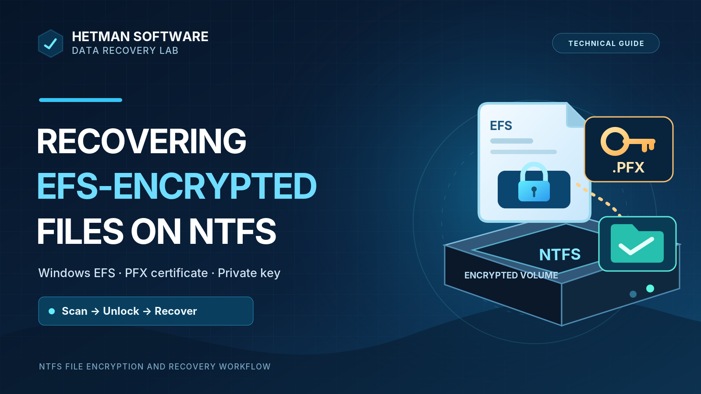

Windows Encrypting File System (EFS) can protect individual files and folders stored on an NTFS volume. If those files are deleted, the partition is formatted or removed, the NTFS filesystem is damaged, or Windows is reinstalled, recovering the file entries is only part of the problem: the encrypted content must also be decrypted with the correct EFS private key.

This guide follows a practical sequence documented in the supplied Hetman Software article: inspect and export the EFS certificate in Windows, then scan an NTFS drive and provide the key to **Hetman Partition Recovery on macOS**. The illustrations below include the original Windows and macOS application screenshots from that article.

For a deleted EFS file, stop writing to the affected disk immediately. The file's content and the NTFS metadata needed to locate it may be overwritten by subsequent writes. On SSDs, TRIM and device behavior may also make removed data inaccessible. There is no guaranteed recovery outcome after deletion or formatting.

## Video demonstration

[Watch the demonstration: recovering deleted EFS files on an NTFS disk](https://www.youtube.com/watch?v=8-E0E0V7A_8). An embedded player is also available in the HTML edition of this article.

## What is Windows EFS?

**Encrypting File System (EFS)** is a Windows feature for encrypting selected files and directories on **NTFS**. It is not whole-volume encryption: the NTFS directory structure still exists, while access to protected file content requires valid EFS cryptographic material. Windows normally manages this access using a user's EFS certificate and corresponding private key.

If an encrypted file is copied to another system without the key, or if Windows is reinstalled and its user profile and keys are lost, the file may remain present but unreadable. An ordinary Windows account password does not replace the private key. EFS file encryption is not available on FAT32 or exFAT.

| EFS component | What it does |
|---|---|
| Storage filesystem | NTFS supports EFS-encrypted files and directories. |
| Encryption scope | Selected files and directories, not the entire storage volume. |
| File encryption key | Protects file contents; the user's certificate and private key are involved in protecting and recovering access to that key. |
| EFS certificate | Identifies the cryptographic identity permitted to access the encrypted file. |
| Private key | Necessary for ordinary decryption by the intended user or an authorized recovery agent. |
| PFX / P12 backup | PKCS #12 export that can preserve the certificate and private key, protected by a password. |
| Deleted-file recovery | Requires the relevant stored file content and filesystem information to remain recoverable. |
| Plaintext recovery | Additionally requires valid key material that matches the encrypted file. |

## EFS versus BitLocker

EFS and BitLocker provide different layers of protection. BitLocker encrypts an entire volume; EFS encrypts selected files within an NTFS volume. They may be used together, but they require different credentials during recovery.

| Property | BitLocker | Windows EFS |
|---|---|---|
| Protection boundary | Volume or drive | Individual NTFS files and folders |
| Primary use | Protecting storage if a device is lost or stolen | Restricting access to selected files between users |
| Unlock material | Appropriate unlock or recovery credentials, commonly a 48-digit recovery password | EFS certificate and matching private key, often exported to `.pfx` |
| After authorization | The volume's filesystem can be accessed normally | Authorized applications can read the protected files normally |
| Recovery of deleted files | First unlock the volume, then analyze its filesystem | Recover the file data and supply valid EFS decryption data |
| Can both be enabled? | Yes, on the volume | Yes, for selected NTFS files on that volume |

A BitLocker recovery key cannot be substituted for an EFS private key. Conversely, an EFS PFX backup will not unlock a BitLocker-protected volume.

## Find the EFS certificate in Windows

When Windows encrypts a file with EFS, it creates or uses an EFS certificate and private key available to the user's profile. To inspect the current user's certificates:

1. Press **Win + R**, type `certmgr.msc`, and press **Enter**.
2. Open **Current User → Personal → Certificates**.
3. Identify the certificate whose intended purpose includes **Encrypting File System**. Confirm that the corresponding private key is present before attempting to export it.

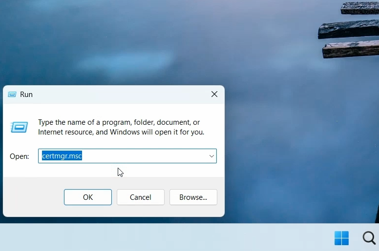

*Figure 1. Open the current user certificate store with certmgr.msc.*

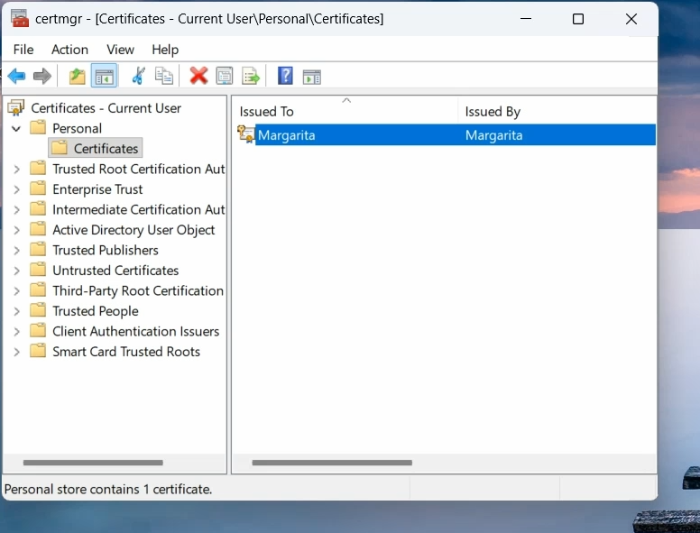

*Figure 2. The user certificate store contains the certificate used for EFS.*

The certificate itself is not enough. Without the matching private key, standard Windows EFS decryption will not work, even if you still know the user's Windows sign-in password.

## Export the EFS certificate and private key to PFX

Windows may display a reminder to back up the file-encryption certificate and key after files are encrypted. The source article also demonstrates manual export through Certificate Manager.

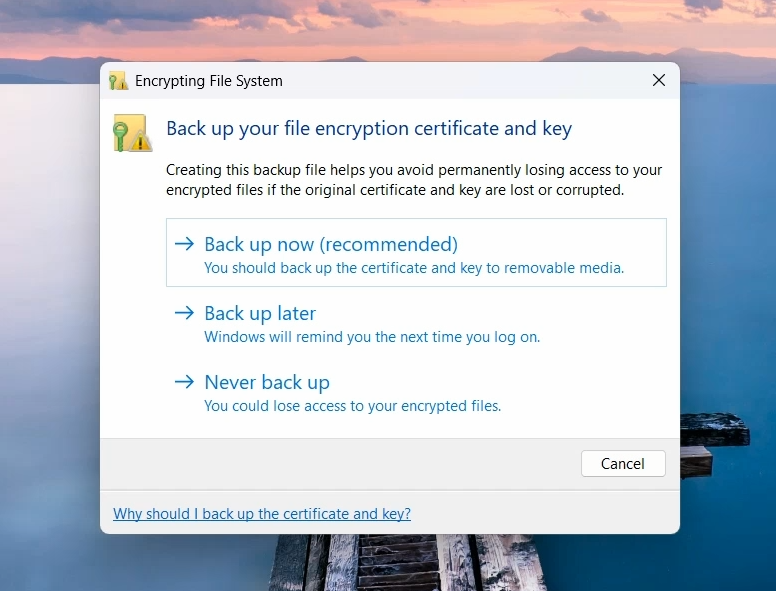

*Figure 3. Windows recommends backing up the EFS certificate and its private key.*

To export the certificate manually:

1. In `certmgr.msc`, go to **Personal → Certificates**.
2. Right-click the relevant EFS certificate and choose **All Tasks → Export**.
3. In the Certificate Export Wizard, select **Yes, export the private key**.
4. Choose **Personal Information Exchange / PKCS #12 (.PFX)**.
5. Set a strong password for the exported file and save the backup on separate, secure storage.

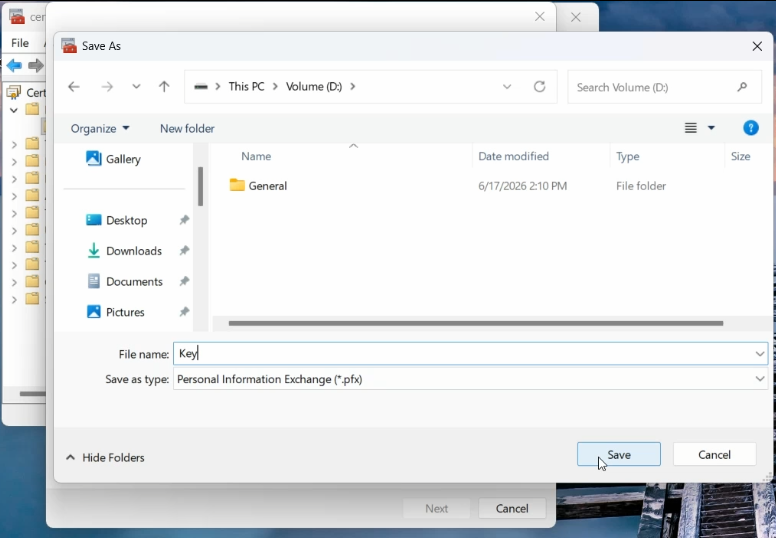

*Figure 4. Save the exported private key and certificate in PKCS #12 (.pfx) format.*

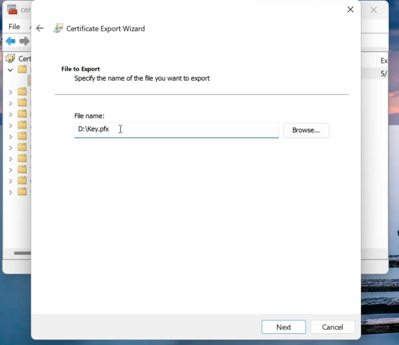

*Figure 5. The Certificate Export Wizard asks for the destination of the PFX file.*

The screenshots show the Windows save and export-path dialogs. The wizard's private-key option and password-protection steps are described in the source text, but are not individually captured in these two screenshots.

**Protect the PFX backup.** Anyone possessing both the exported private key and its password could potentially access files encrypted for that certificate. Keep the PFX away from the affected NTFS drive so a disk failure cannot destroy both the data and the recovery key.

## What if the EFS private key is missing?

A recovery program can sometimes locate deleted encrypted file records, restore the encrypted content, or find a previously saved PFX backup. It **cannot derive an EFS private key merely from a Windows account password**, nor can it guarantee decryption after the appropriate private key has been lost.

If Windows was reinstalled and the old user profile is gone, check whether a certificate backup or an authorized EFS recovery-agent key is available. Without usable matching key material, recovery of the encrypted file bytes does not imply recovery of readable plaintext.

## Recover deleted EFS-encrypted files in Hetman Partition Recovery

The application portion of the supplied demonstration is shown **on macOS**, although the EFS certificate was handled in Windows. The screenshots show a mounted removable NTFS volume and the Hetman Partition Recovery file-recovery interface. They do not document a disk-image acquisition procedure or individual drive-sector parameters.

### Step 1: Open the NTFS drive

Launch Hetman Partition Recovery and select the NTFS volume that contains the encrypted files. The screenshot shows a removable drive with an `NTFS Partition (EFS)` entry.

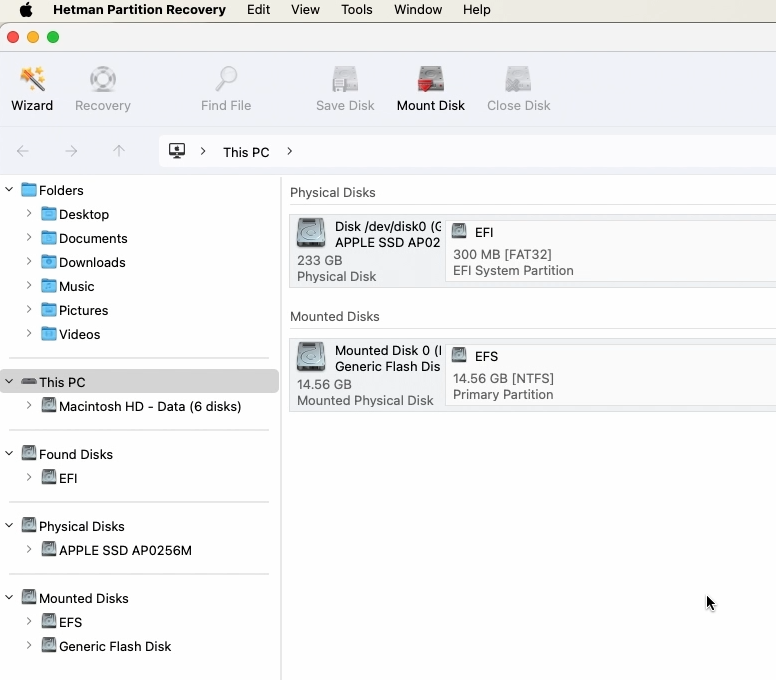

*Figure 6. Hetman Partition Recovery displays the NTFS volume on a mounted removable drive in macOS.*

### Step 2: Scan the filesystem

Start the analysis wizard. If NTFS metadata is still intact, **Fast scan** is a reasonable starting point, as shown in the demonstration. If expected files are absent or the filesystem is damaged, more extensive analysis may be needed; the source screenshots do not compare scan algorithms or record numerical results.

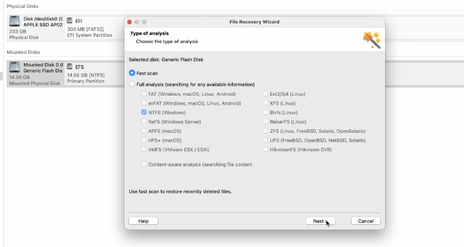

*Figure 7. Fast scan is selected in the file recovery wizard.*

### Step 3: Identify deleted and encrypted objects

After scanning, the browser shows file names, directories, and deleted-file markers. The EFS padlock symbols distinguish encrypted objects. Until the matching decryption data is provided, content previews for those objects may be unavailable.

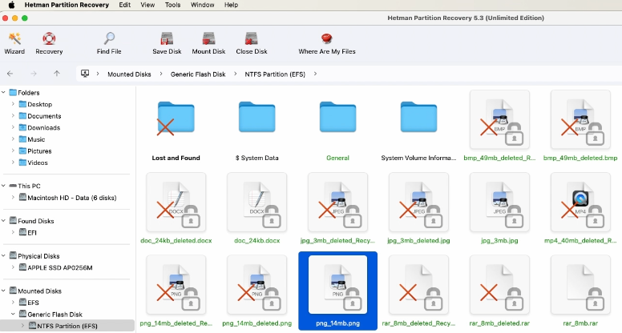

*Figure 8. The scan results include deleted entries and EFS-encrypted files that cannot yet be previewed.*

### Step 4: Add the EFS decryption data

Select a file that requires decryption. In the preview area, click **Add Decryption Data**. Alternatively, use the corresponding command in the **Tools** menu. In the dialog, select the **Encrypting File System (EFS) certificate** type and provide the certificate file and its password.

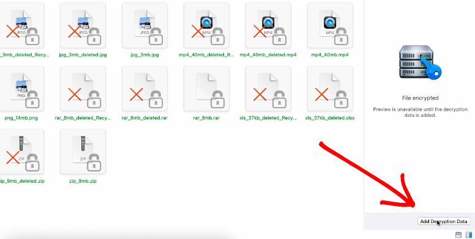

*Figure 9. Use Add Decryption Data when the preview pane reports that decryption data is required.*

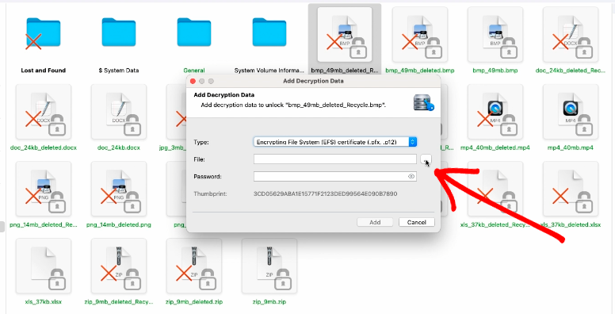

*Figure 10. Select the EFS certificate file in the Add Decryption Data dialog.*

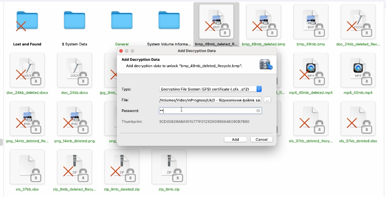

*Figure 11. Supply the selected certificate file and its password to unlock EFS content.*

The correct PFX/P12 certificate backup must contain the matching private key. A different certificate, missing private key, or incorrect backup password will not provide the required access.

### Step 5: Preview and save recovered files

Once the valid decryption material has been supplied, the demonstration shows previews of file contents and multiple items selected for recovery. Select the needed entries, choose **Recovery**, and save the output to **a different physical drive**.

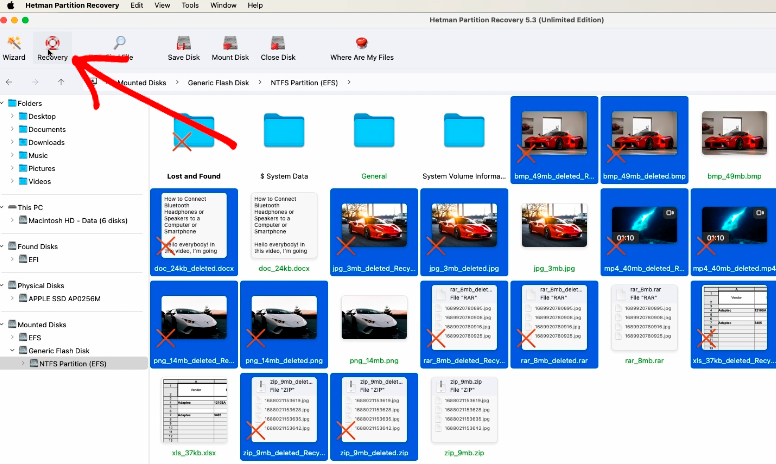

*Figure 12. After decryption data is supplied, file previews are visible and files can be selected for recovery.*

Do not save recovered data back to the drive being scanned: new writes may overwrite deleted content and reduce subsequent recovery opportunities.

## What the demonstration actually shows

The screenshots document three observable stages: encrypted file entries discovered in the NTFS directory view, the EFS decryption-data dialog accepting a certificate file and password, and accessible previews shown afterward. The visible application window identifies **Hetman Partition Recovery 5.3**. The material does **not** provide a count of detected, previewed, exported, or integrity-verified files, nor a separate test for every possible loss scenario discussed in the introduction. No file hashes or post-export validation logs are supplied. The presence of readable previews is therefore not a quantified measure of recovery success.

## Conclusion

Recovering a deleted EFS file requires both recoverable NTFS data and an appropriate EFS private key. If deletion has not overwritten the relevant disk contents and a valid PFX backup is available, recovery software can help locate the file, supply the decryption material, preview its contents, and export selected results. Without the necessary key, a restored encrypted file may remain unreadable.

The safest practical procedure is to avoid further writes to the source drive, preserve the certificate and private key in an off-device PFX backup, analyze the affected NTFS volume, verify the content that can be previewed, and save recovered files to a separate destination.