# Synology DS409 RAID1 to RAID5 migration interrupted at 29.55%: what survived after losing an original disk?

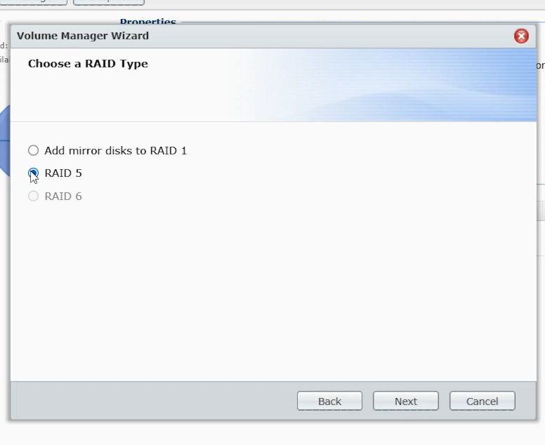

We reproduced a specific Synology NAS failure scenario that can be confusing during recovery: a **RAID1 → RAID5 migration** was interrupted by a power loss, and then **one of the two original RAID1 disks was no longer available**. The result was not simply a degraded RAID5. Part of the address space had already been reshaped into the new RAID5 layout, while another part still reflected the earlier RAID1 layout.

The goal of this experiment was not to bring the NAS back online. We wanted to determine:

- what the two remaining physical disks could still reveal about the array;
- whether the current RAID5 geometry could be detected automatically;
- whether part of the old RAID1 layout was still recoverable;
- how the recovery results differed between the **new** and **old** geometries.

All reconstruction in this test was done **virtually and read-only**. Nothing was written back to the original NAS disks.

## Test environment

- **NAS:** Synology DS409
- **DSM:** 4.2-3250
- **Drives:** three Seagate ST332031 1CS drives, each displayed as 298.09 GB
- **Original data array:** RAID1 on Disk 1 + Disk 2
- **Filesystem:** Ext4
- **Original volume size:** 288.98 GB
- **Test data written before failure:** 110.71 GB of documents, images, archives and videos
- **Migration target:** RAID1 → RAID5 after adding Disk 3

### Baseline configuration

The original test array was a standard two-disk RAID1. The screenshots below show the disks selected for the initial array and the migration being prepared.

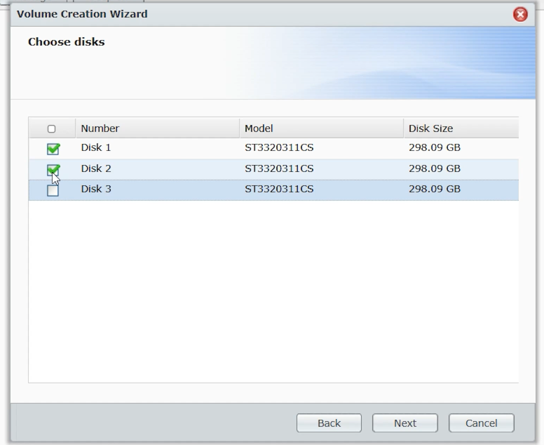

*Initial two-disk RAID1 configuration in Synology DSM.*


*The third disk was added in preparation for changing the array from RAID1 to RAID5.*

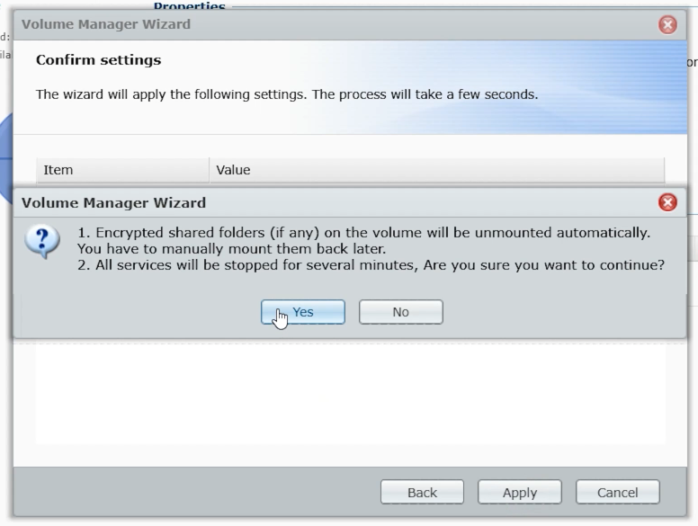

*DSM confirmation dialog for the RAID1 to RAID5 migration.*

## Failure scenario

We started the migration and intentionally interrupted it with a hard power cut when DSM reported **29.55%** progress.

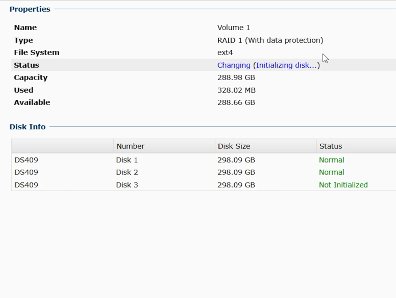

*The reshape was interrupted at 29.55% without a graceful shutdown.*

After that, we simulated the complete loss of **one original RAID1 disk**. The only surviving members available for analysis were:

- the other original RAID1 disk, already partially modified by the reshape;
- the new disk that had been added for RAID5.

At that point, there was no intact original mirror anymore. The surviving disks had to be interpreted in the context of an **unfinished RAID transformation**.

> **Important note:** 29.55% is only the progress value shown by DSM. It should not be interpreted as a precise byte boundary of the reshaped area.

## Automatic detection of the current RAID5 geometry

After connecting the two surviving disks to a Windows workstation, Hetman RAID Recovery automatically detected the current main data array as a **three-member RAID5 with one missing member**.

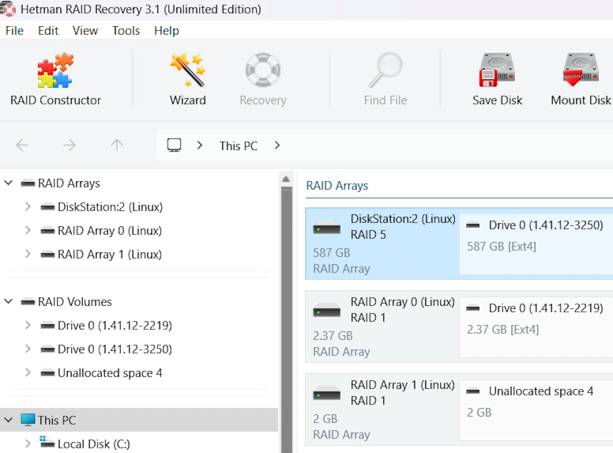

*The software automatically detected the main Synology data array as a degraded RAID5.*

The detected properties were:

| Property | Value |
|---|---|
| RAID level | RAID5 |
| Member state | 2 of 3 available |
| Layout | Left Synchronous |
| Chunk size | 64 KiB |
| Data offset | 4,832,886,784 bytes |
| Filesystem | Ext4 |

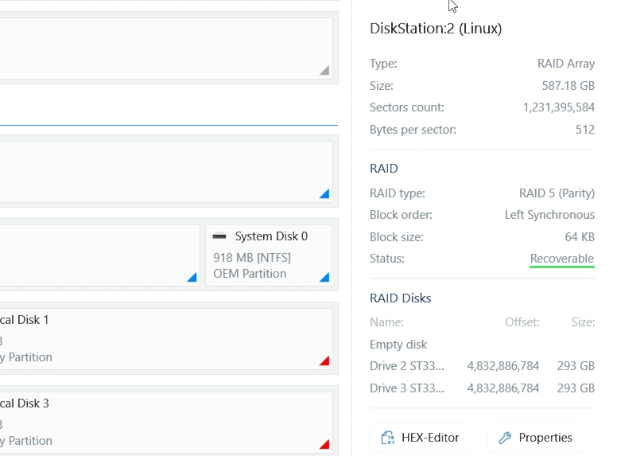

*Detected RAID5 properties, including layout, chunk size and offset.*

The software also detected the small Synology system/service RAID1 structures separately. This is important because those arrays should not be mistaken for the user-data volume.

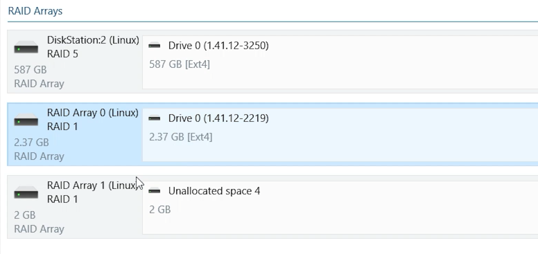

*The small Synology service partitions were detected separately from the main user-data array.*

## Scanning the automatically detected RAID5

We ran a **Fast scan** on the detected RAID5 volume.

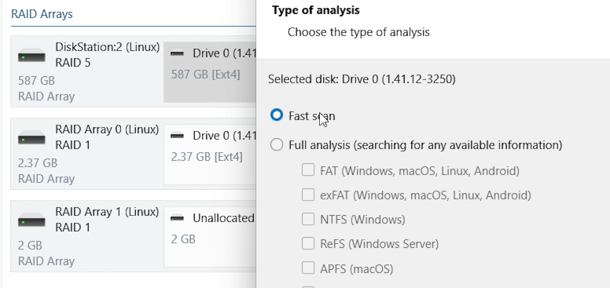

*Fast scan of the detected RAID5 volume.*

The scan found:

- **390 folders**
- **8,239 files**

The directory tree was partially available, and part of the original test data could be previewed and copied.

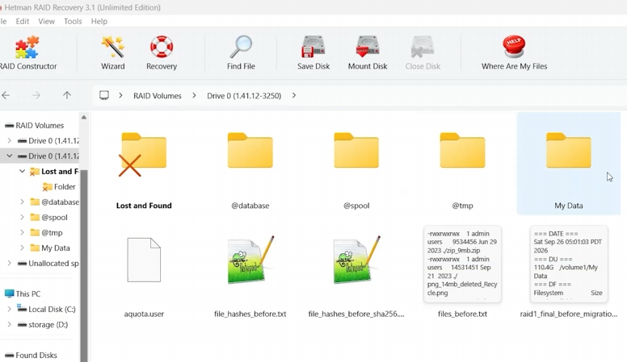

*Part of the original files and folders were visible on the reconstructed RAID5.*

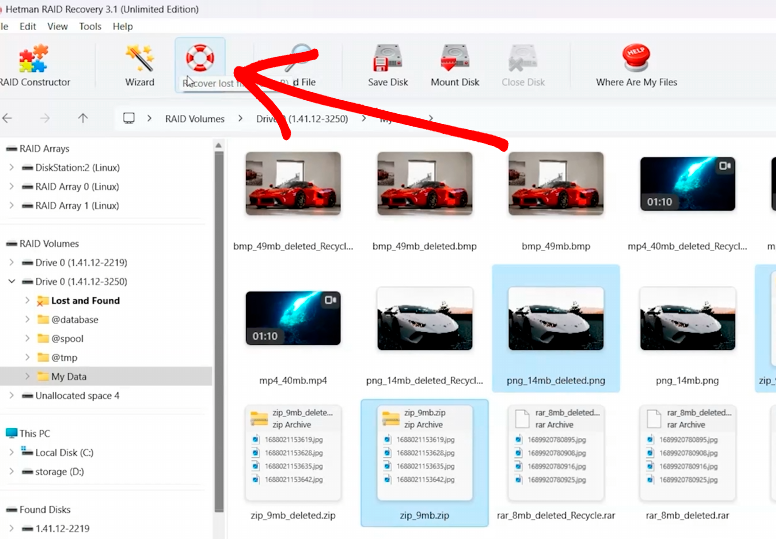

*Copying recoverable files from the automatically detected degraded RAID5.*

However, the result was incomplete. Some of the original files were missing, which suggested that analyzing only the **new RAID5 geometry** was not enough.

## Why the old RAID1 layout still matters

A reshape that is interrupted mid-process may leave different parts of the logical address space encoded according to **different layouts**. Some regions may already correspond to the new RAID5 organization, while other regions may still reflect the earlier RAID1 state.

That is why we also examined the disks manually.

## Manual analysis of the MD metadata

To verify the offsets independently, we checked the disk structure in the hex editor.

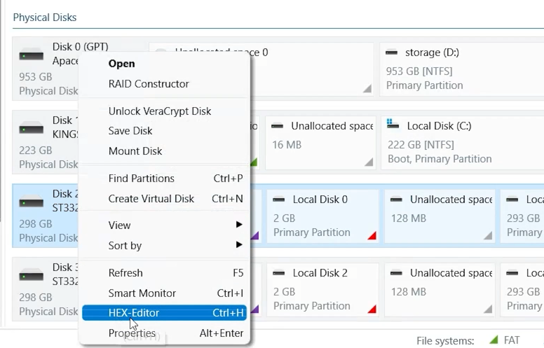

*Opening a physical Synology member disk in the built-in hex editor.*

The data-member partition began at **LBA 9,437,184**.

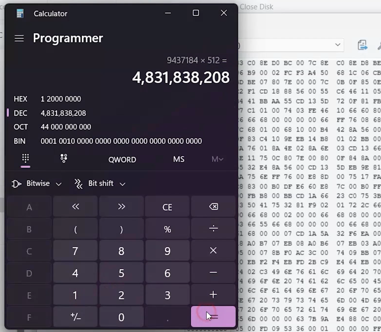

*The large data partition started at LBA 9,437,184.*

Next, we located the Linux MD superblock signature `A92B4EFC`.

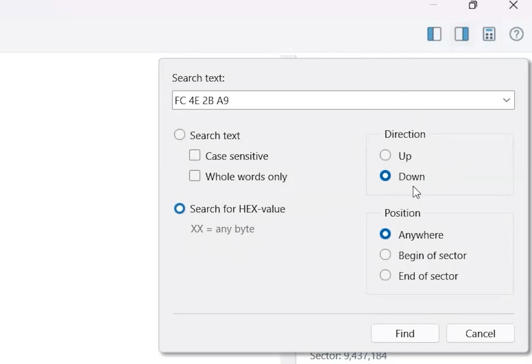

*Searching for the Linux MD superblock signature.*

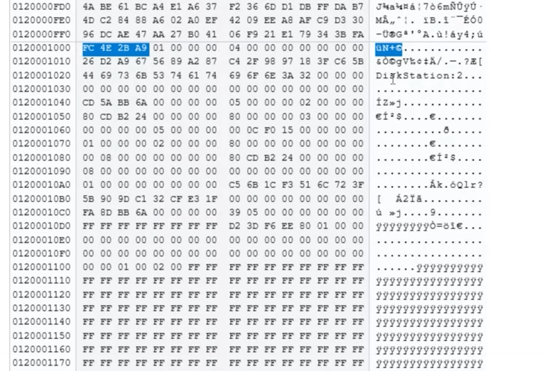

*The MD superblock was found at the expected location.*

Inside the superblock, the `data_offset` field showed the member-data start relative to the partition beginning.

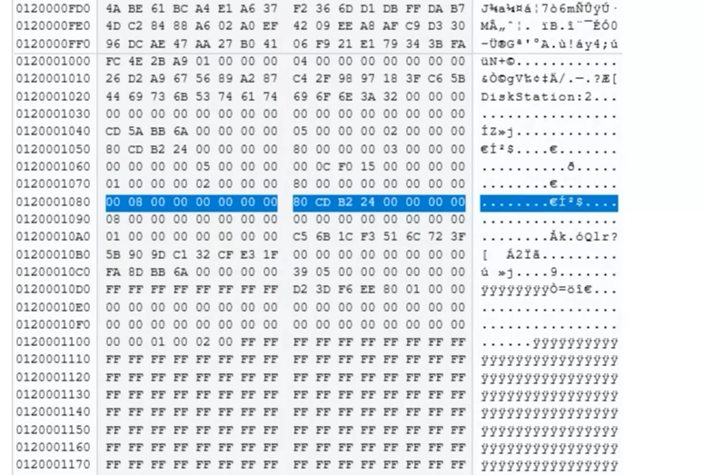

*The MD superblock contained the data_offset field needed for manual reconstruction.*

The resulting data offset for the RAID members was:

```text
(9,437,184 + 2,048) × 512 = 4,832,886,784 bytes
```

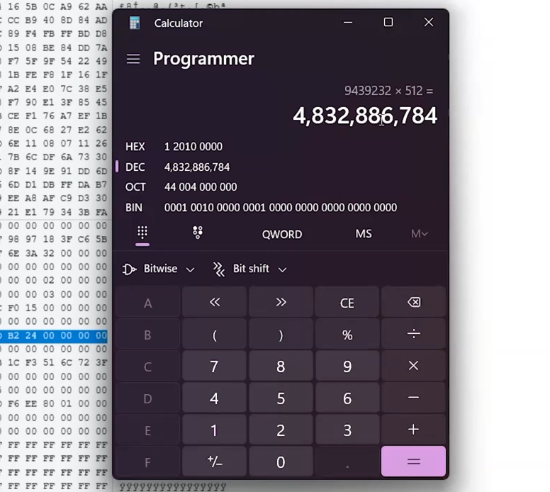

*Calculated absolute data offset for the RAID members.*

## Manual reconstruction of the new RAID5 layout

Even though the RAID5 was detected automatically in our case, we also rebuilt it manually to test the fallback workflow for cases where automatic detection fails.

We opened **RAID Constructor** and created a degraded three-member RAID5 using the two surviving disks and one **Empty disk** placeholder.

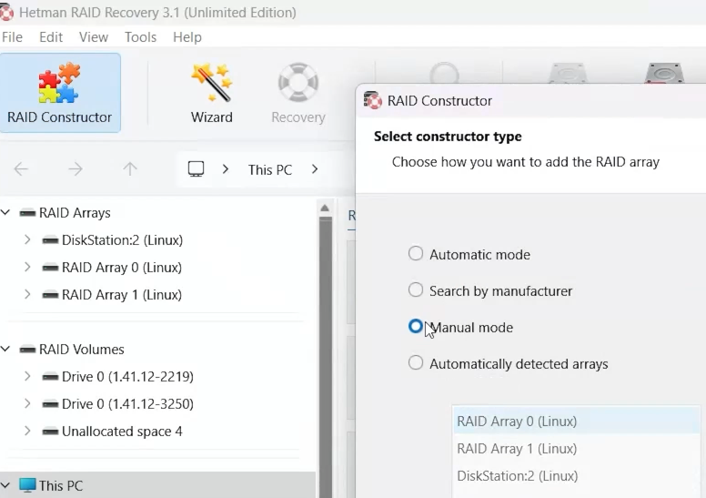

*Opening RAID Constructor for manual recovery.*

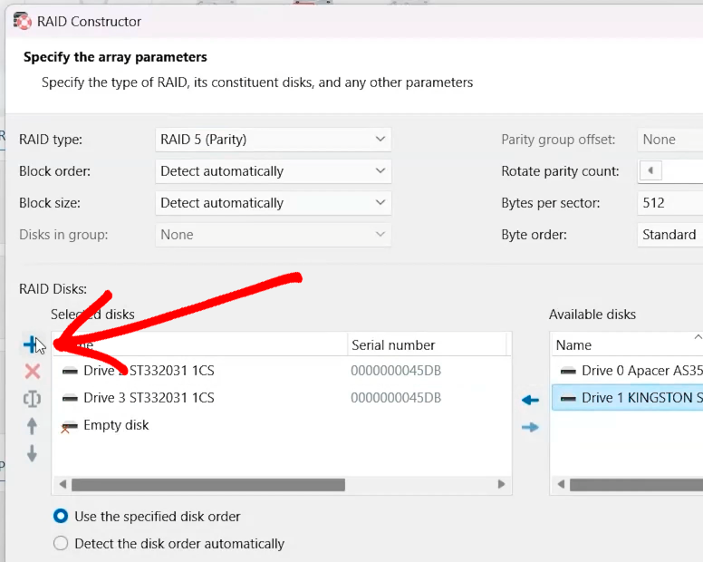

*The missing RAID5 member was represented by an Empty disk placeholder.*

The candidate configuration used:

- RAID5
- Left Synchronous layout
- 64 KB chunk size
- 512-byte sectors
- the calculated data offsets for the surviving members

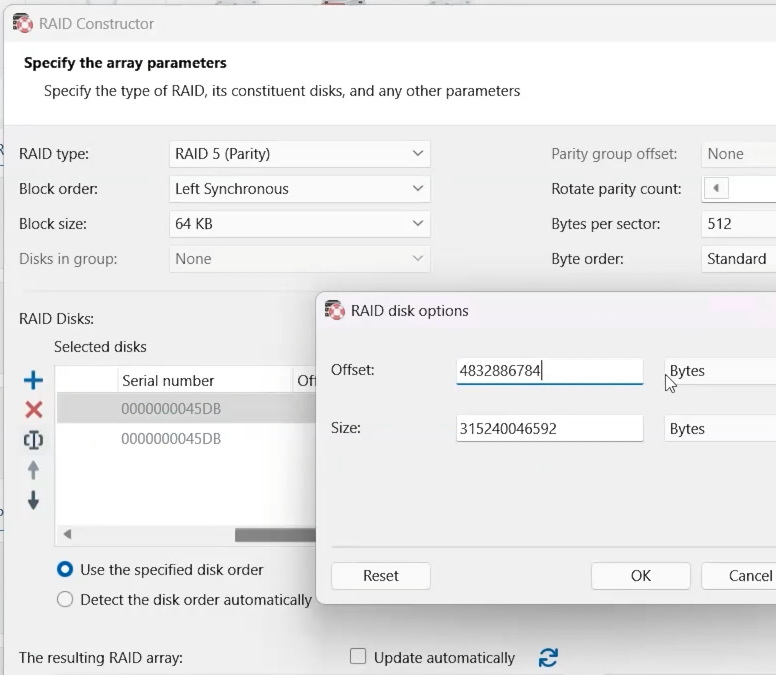

*The correct member data offsets were set manually.*

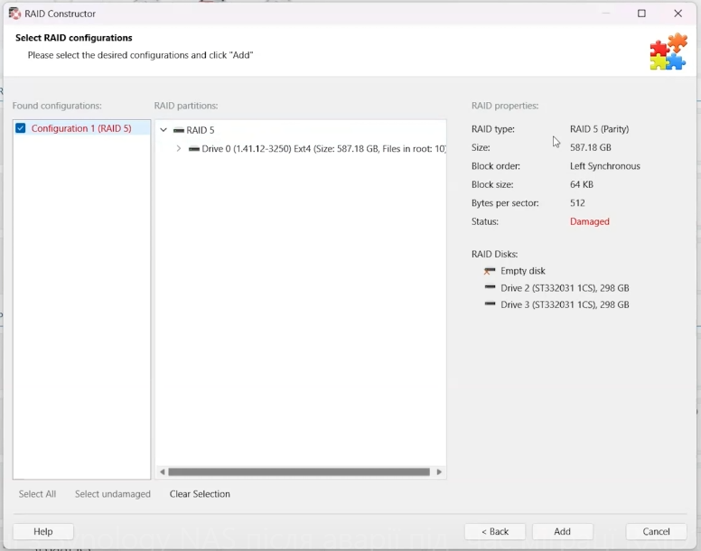

*Automatic permutation testing returned a plausible RAID5 configuration.*

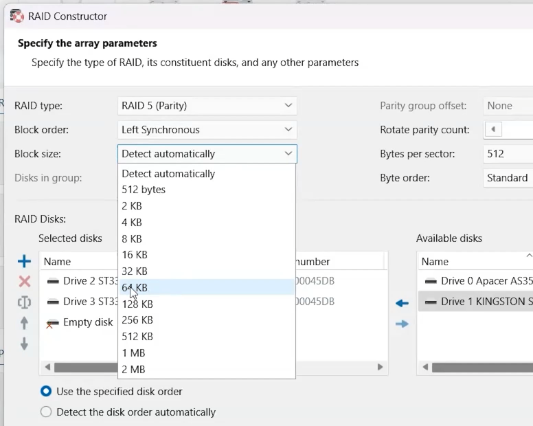

*Left Synchronous parity layout with 64 KB blocks.*

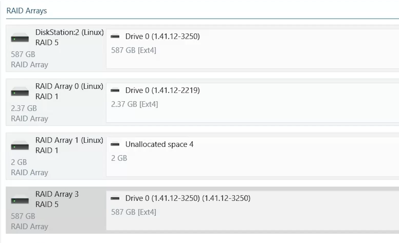

*The manually reconstructed degraded RAID5 was added to the disk list.*

This confirmed that the current RAID5 geometry itself was not the core problem. The bigger issue was that the reshape had not finished across the entire data area.

## Manual reconstruction of the old RAID1 layout

To check the unconverted region, we reconstructed the **old RAID1** manually using the surviving original mirror member and an **Empty disk** placeholder.

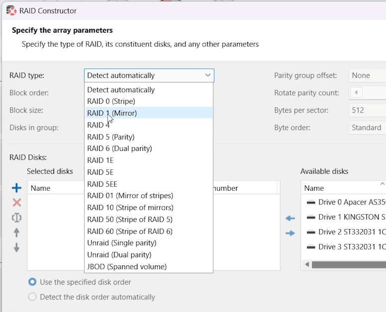

*Selecting RAID1 for manual reconstruction of the earlier array layout.*

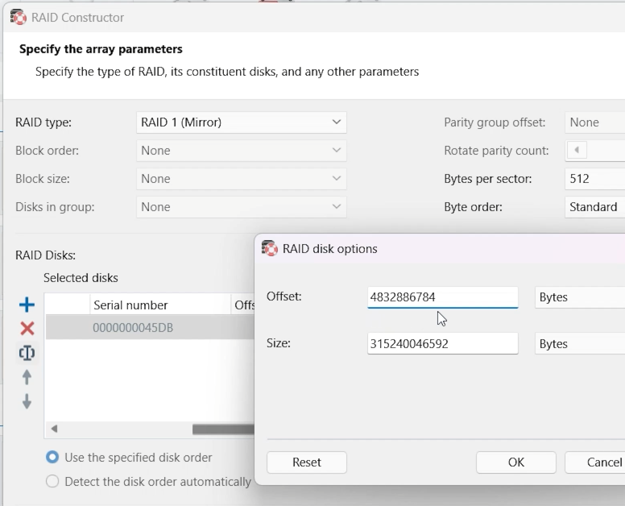

*The same calculated data offset was applied to the RAID1 reconstruction.*

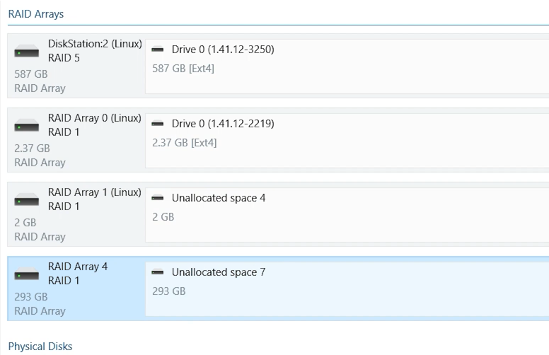

*The old RAID1 geometry was reconstructed virtually using one surviving original member and one Empty disk placeholder.*

We then ran **Full analysis** on the Ext4 volume found in that reconstruction.

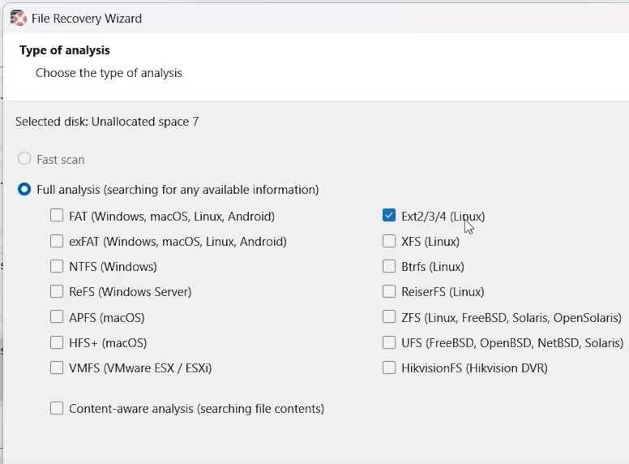

*Full analysis of the reconstructed RAID1 volume.*

The scan found:

- **979 folders**
- **14,049 files**

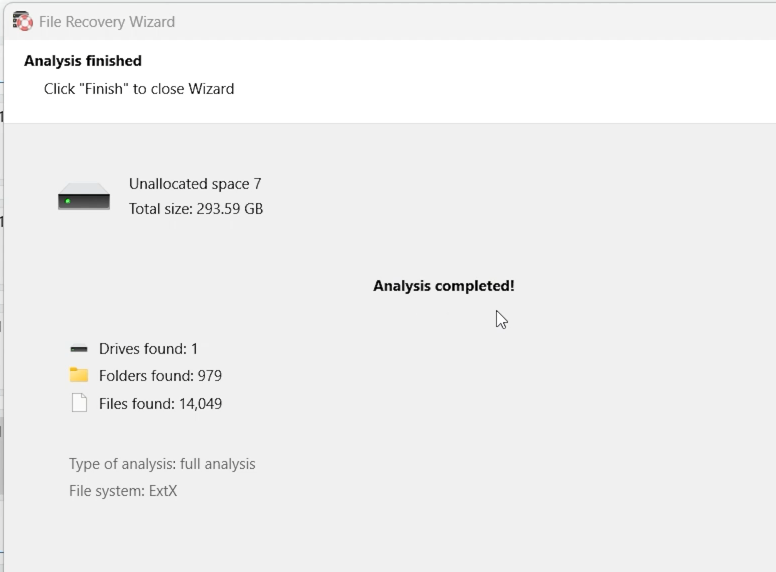

*The reconstructed RAID1 produced a larger file set than the current RAID5 view.*

This file set was significantly larger than what we saw through the current RAID5 geometry.

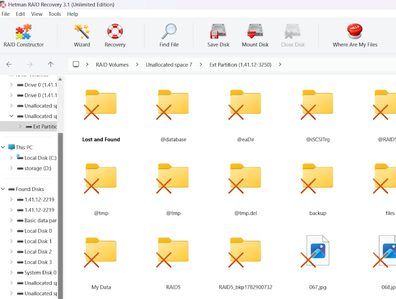

*Browsing the recovered directory tree from the reconstructed RAID1.*

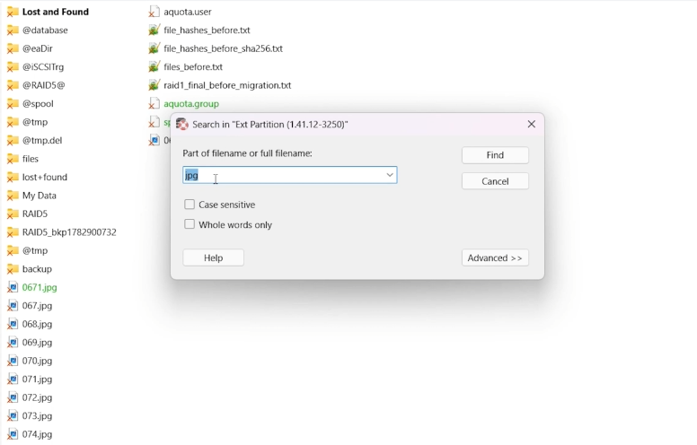

*Recovered files could be checked by name and previewed before export.*

## Results and interpretation

The experiment showed that an interrupted RAID1 → RAID5 migration cannot always be analyzed as a simple degraded RAID5.

### What we confirmed

- The **current** geometry could be detected as a degraded RAID5.
- The current RAID5 view allowed access to part of the user data.
- The MD metadata was sufficient to verify the **actual data offset** independently.
- A separate reconstruction of the **old RAID1 geometry** revealed additional folders and files.

### Practical recovery lesson

When a Synology reshape is interrupted and one of the original disks is later lost, **do not assume that only the new array layout matters**. You may need to examine both:

1. the **new** partially built RAID5 geometry;
2. the **old** pre-migration RAID1 geometry.

The old RAID1 reconstruction yielded a larger set of detected file records. Because the RAID5 and RAID1 results used different scan modes (Fast scan versus Full analysis), the file counts are not a direct measure of the number of fully recoverable files; integrity must be checked file by file.

## Conclusion

In this Synology DS409 test, an interrupted RAID1 → RAID5 migration left behind a mixed on-disk situation: some data could be interpreted through the degraded RAID5, while other data was more completely recovered by reconstructing the earlier RAID1.

The main takeaway is simple: **after an interrupted Synology migration, recovery should not stop at the automatically detected current array**. If the results look incomplete, inspect the metadata, verify the offsets, and test the earlier geometry as well.