# VeraCrypt recovery lab: file containers, hidden volumes, and deleted encrypted partitions

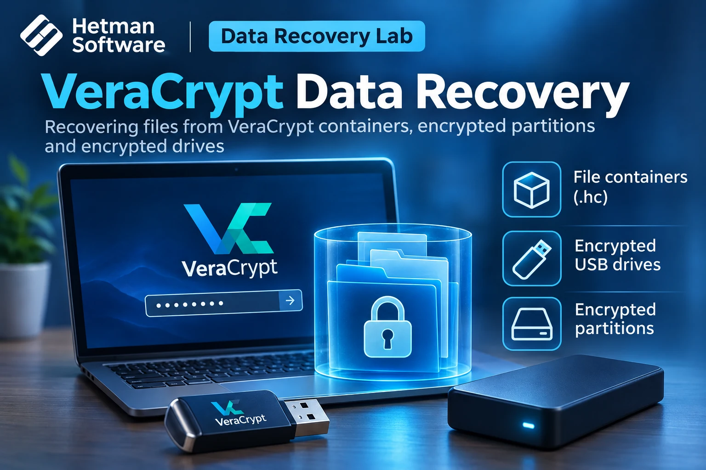

## Research question and scope

This case study examines whether previously stored and deleted files remain discoverable after an existing VeraCrypt file container, standard encrypted USB volume or hidden VeraCrypt volume is unlocked in a filesystem recovery tool. It also examines how to analyze encrypted volumes when their partition-table entries have been removed.

The source is a Ukrainian test script containing application screenshots. The evidence shows successful unlock operations, identified filesystems and file entries in the analysis interface. **It does not record the number of files exported to another device, independent integrity checks, password recovery, or tests of each supported cipher.** We therefore separate those outcomes below.

## Test environment and storage configuration

| Property | Recorded observation |
|---|---|
| Recovery application | Hetman Partition Recovery **5.3 Home Edition** (shown in screenshots) |
| Operating environment | Windows desktop (version not recorded) |
| VeraCrypt version | Not recorded |
| File container | VeraCrypt container loaded as RAW disk image, approximately **2 GB** in the application |
| USB device | **Generic Flash Disk**, capacity **14.56 GB** as displayed |
| Filesystem in unlocked container | **NTFS** |
| Standard VeraCrypt USB volume | **NTFS**, shown as **14.56 GB** in reconstructed virtual disk view |
| Hidden VeraCrypt volume | **exFAT**, shown as **1,023.88 MB** |
| Authentication | Password; separate outer/hidden credentials; interface also supports PIM and key files |
| Test dataset | Documents, photographs, videos and other files, with deletion-marked entries visible; baseline totals not recorded |
| Storage sector size | Not explicitly documented; offsets are supplied in sectors |
| Ciphers and hash/KDF configuration | Not recorded for the tested volumes |

The three workflows are related but distinct. The `.hc` file-container test begins with an extant encrypted file. The USB test unlocks an existing encrypted volume. The deleted-partition scenario begins with a device shown as unallocated and reconstructs a candidate virtual view of the previous encrypted partition.

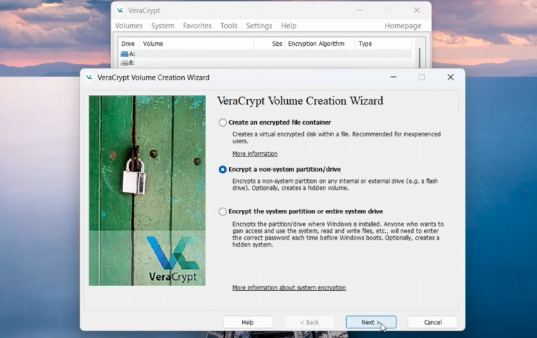

*Figure 1. VeraCrypt volume creation wizard showing file-container and partition-based encryption options.*


## Safety and acquisition

The source recommends preserving the affected device, avoiding new files or formatting, creating a disk image when the data are valuable, and saving recovered files to **another physical device**. The screenshots do not document a completed forensic acquisition, image hash, hardware write blocker, or write-protection validation; those measures must not be claimed as performed.

In the deleted-partition workflow, **Create virtual disk** is used in the recovery application. It is distinct from using Windows Disk Management to initialize or format a new partition. The screenshots show a virtual reconstruction, not a successful in-place repair of the original partition table.

## Experiment 1 — VeraCrypt file-container recovery

### Import the encrypted container as a RAW disk

The recovery application is opened, **Mount Disk** is selected, and **RAW disk images** is chosen. The VeraCrypt file is located in the filesystem; the script notes that a container can have the `.hc` extension and may require selecting *All files* in the file dialog.

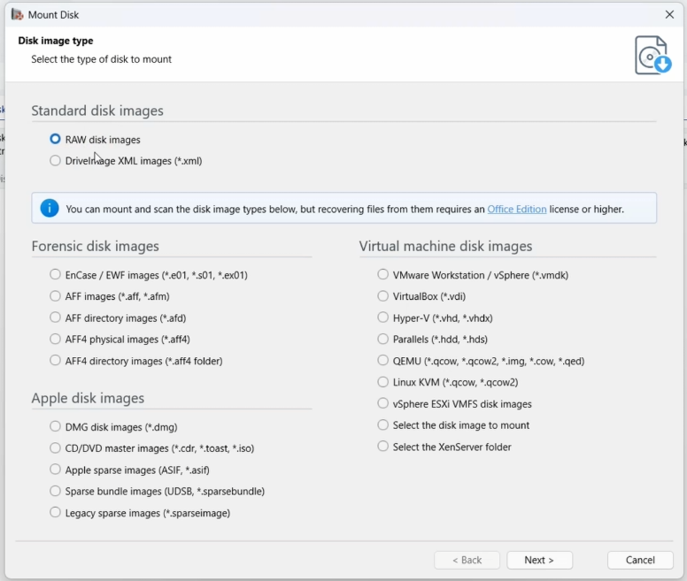

*Figure 2. The file container is added through the RAW disk image workflow.*


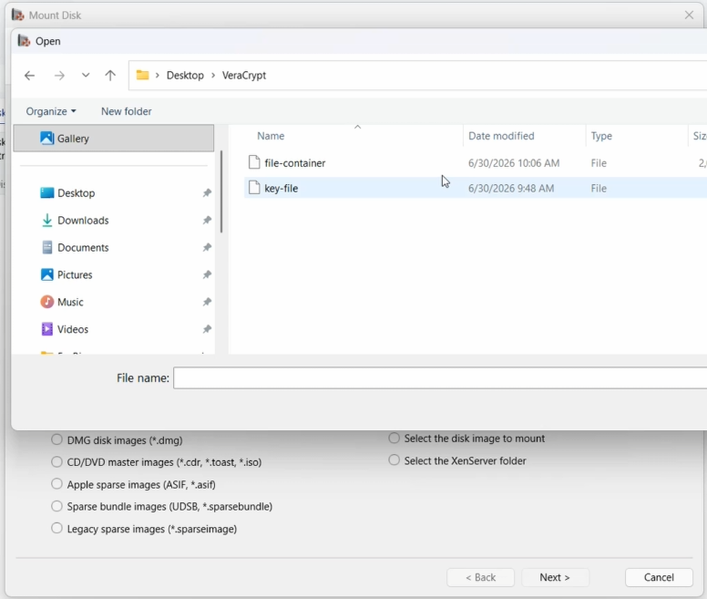

*Figure 3. Selecting the stored container file; a separate key file is visible in the source directory.*


The application lists the imported file as a mounted RAW disk with a capacity of about 2 GB. The operator opens its context menu and selects **Unlock VeraCrypt Disk**.

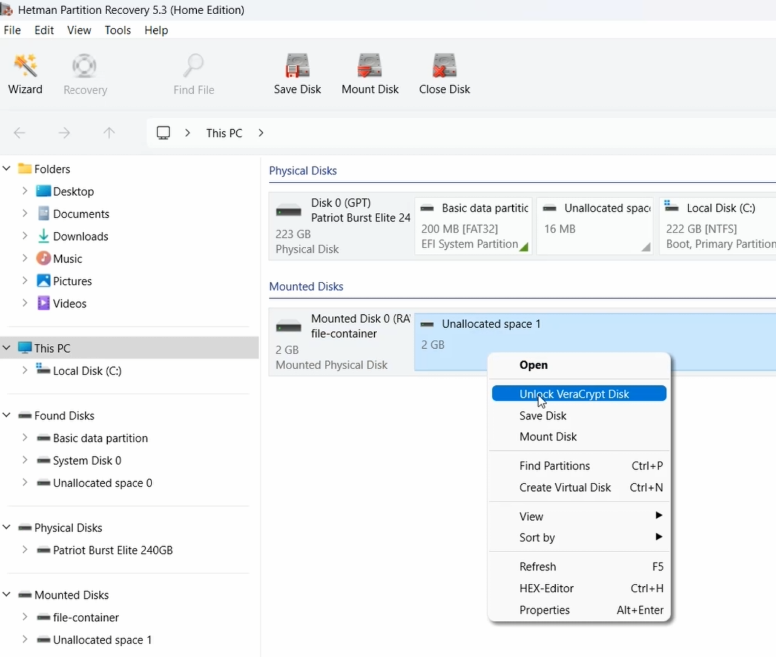

*Figure 4. The imported 2 GB container appears as a mounted RAW disk and can be unlocked from the context menu.*


### Unlock and inspect the NTFS volume

The unlock dialog requests the password and also provides optional controls for **PIM** and **Key Files**. The screenshot shows a PIM field but does not prove a non-default PIM or key file was used. The correct access parameters are required; scanning ciphertext directly cannot reveal the encrypted filesystem structure.

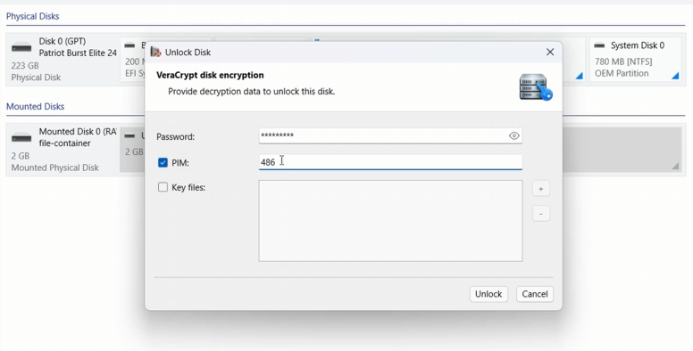

*Figure 5. The VeraCrypt unlock dialog exposes password, PIM and key-file controls; the image does not establish that every option was used in this test.*


After unlocking, the application identifies the container as an **NTFS** logical volume. The script directs the operator to use a **Fast scan** initially and a **Full analysis** if needed; the source does not give reproducible timing or a scan count for this scenario.

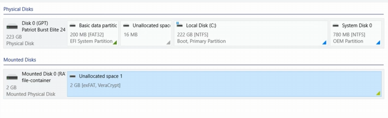

*Figure 6. After unlocking, the container appears as an NTFS volume available for filesystem analysis.*


The result browser contains file entries, including deletion indicators. This confirms that file entries were **detected and presented** in the recovered filesystem view. The screenshots do not establish the byte-level integrity or export completion of each item.

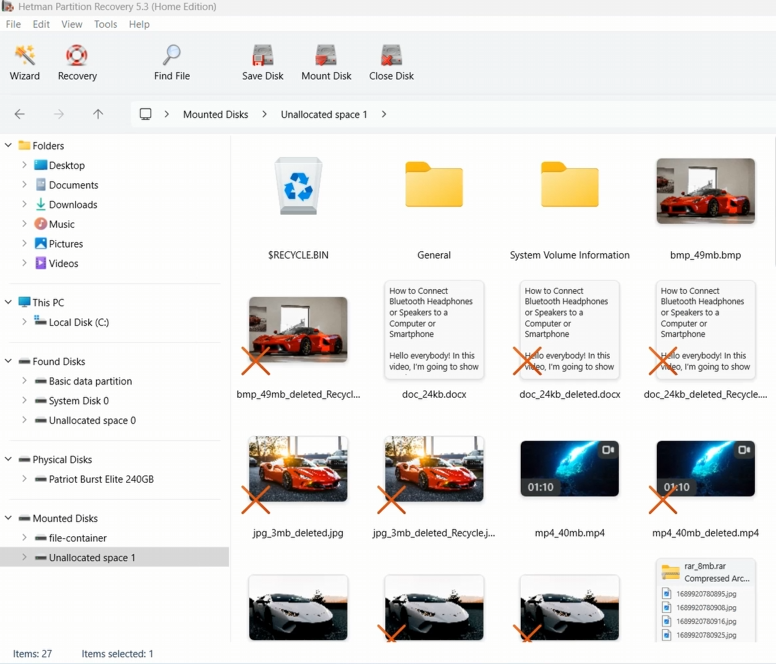

*Figure 7. The result view includes files and deletion markers inside the decrypted container; the screenshot does not quantify validated exports.*


## Experiment 2 — Encrypted USB: standard and hidden volumes

The removable **Generic Flash Disk** is selected in the application, and **Unlock with VeraCrypt** is invoked for its encrypted volume. The outer (standard) volume is unlocked using its own password, with PIM and key-file parameters available if configured.

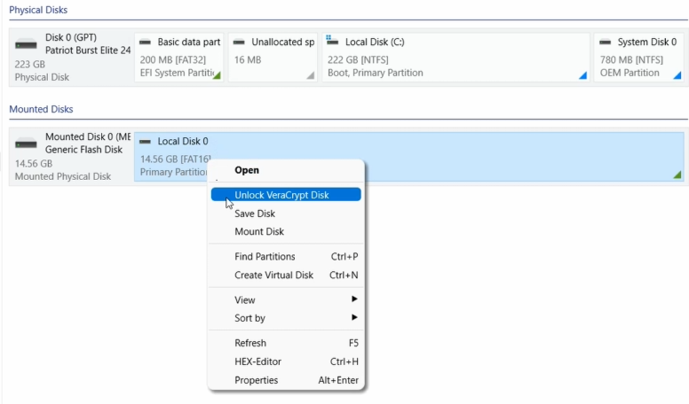

*Figure 8. The encrypted USB volume is selected and Unlock with VeraCrypt is available.*


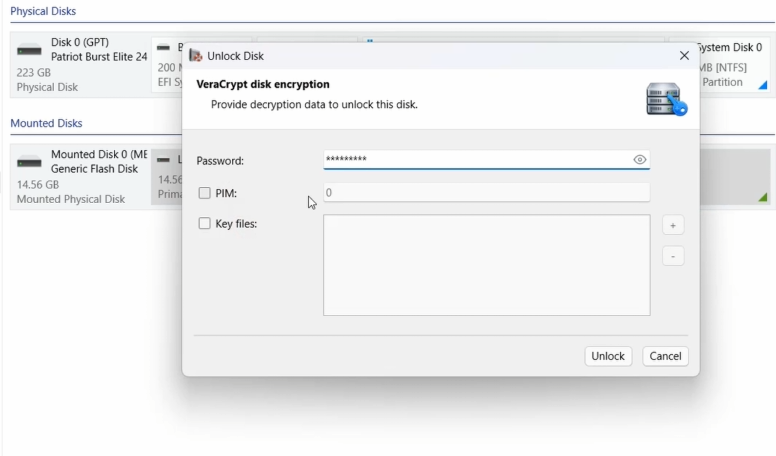

*Figure 9. Credentials are entered to access the standard volume separately from the hidden volume.*


### Analyze the decrypted standard volume

The operator selects the *decrypted logical volume*, rather than scanning the encrypted raw device as though it were an ordinary filesystem. A Fast scan dialog is shown, followed by result listings containing existing and deletion-marked items.

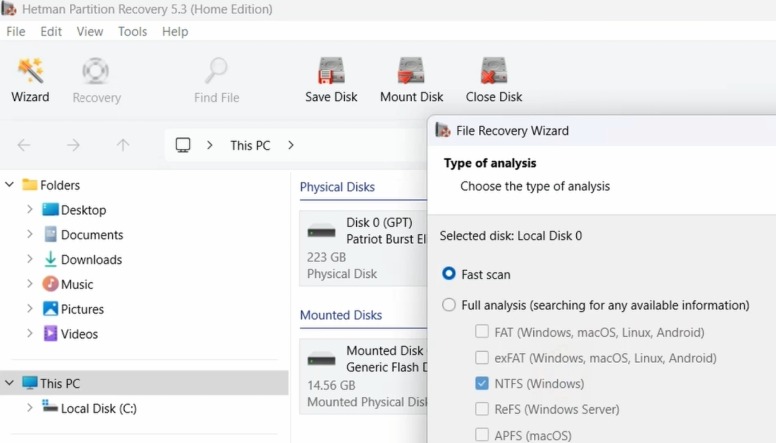

*Figure 10. The unlocked volume is analyzed using the Fast scan option.*


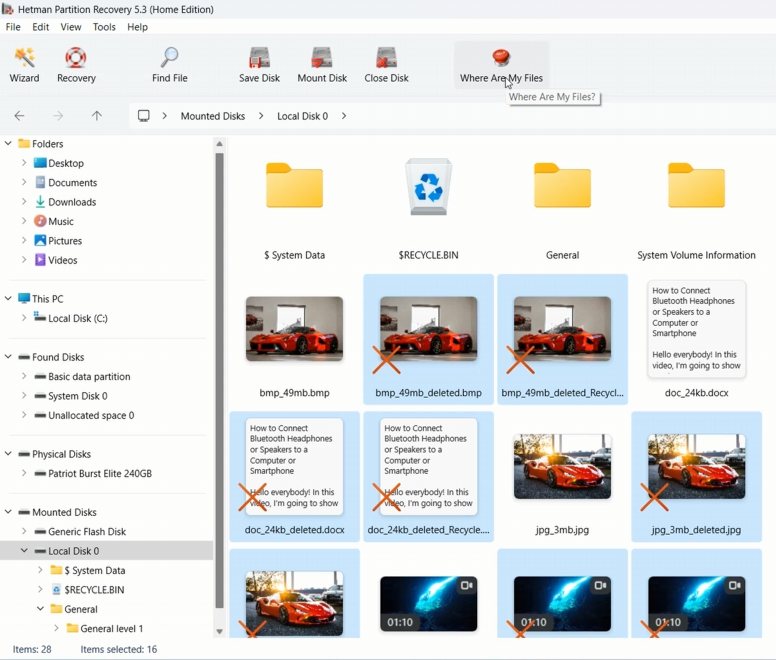

*Figure 11. The standard volume lists existing and deleted file entries; file previews and export totals are not logged.*


### Hidden volume distinction

The hidden VeraCrypt volume is not discoverable just by browsing the unlocked outer filesystem. The script demonstrates reopening the encrypted volume with a **different password** associated with the hidden volume, producing a separate decrypted view. Accordingly, an apparent lack of hidden files while the outer volume is unlocked is not evidence that the hidden volume does not exist.

This experiment illustrates credential-based access to both volumes, not brute-force password recovery or automatic detection of an unknown hidden volume.

## Experiment 3 — Lost partition table after `diskpart clean`

### Starting state

The script discusses partition records removed by the Windows command `diskpart clean`; the underlying command-session log is not provided. The observed result in Windows Disk Management is that the **14.56 GB** USB drive appears **unallocated**. Neither the picture nor the script establishes that the encrypted user sectors were overwritten.

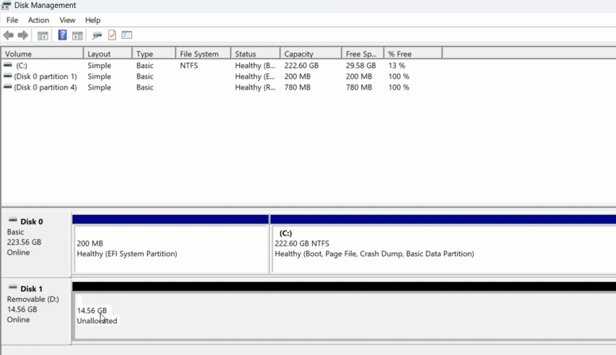

*Figure 12. Windows Disk Management presents the 14.56 GB removable drive as unallocated following partition-table loss.*


### Define the candidate encrypted partition boundaries

In Hetman Partition Recovery the operator selects the entire physical USB device and chooses **Create virtual disk**. This operation defines a virtual range corresponding to the candidate lost volume. The recorded dialog values are:

```text
Source physical device: Generic Flash Disk (14.56 GB as displayed)
Virtual disk start: 2,048 sectors
Virtual disk length: 30,533,632 sectors
Reported physical sector span: 30,535,680 sectors
```

These are observations from the specific interface screenshot, **not universal VeraCrypt offsets**. The sector size and the derivation of these boundaries are not separately verified in the script; applying them to another device without analyzing its layout could produce a false reconstruction.

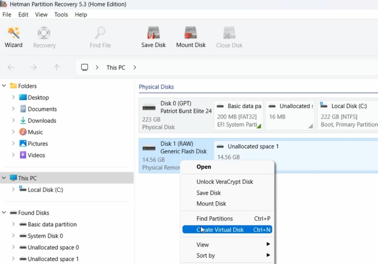

*Figure 13. A virtual disk is constructed for the lost encrypted partition without demonstrating a partition-table rewrite.*


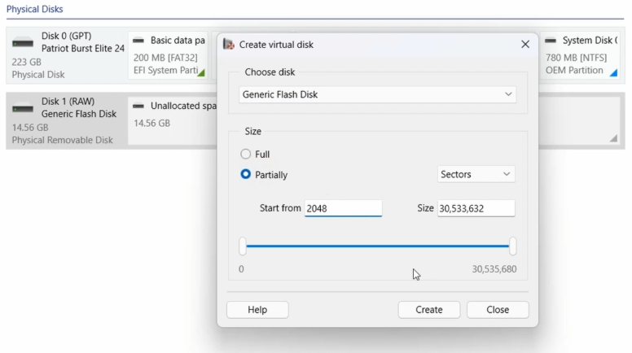

*Figure 14. The demonstrated virtual disk starts at sector 2,048 and has a selected length of 30,533,632 sectors; these values are specific to this screenshot.*


### Unlock the reconstructed standard NTFS volume

The application lists **Virtual Disk 0**, which is unlocked via **Unlock VeraCrypt Disk** with the standard-volume credentials. It is then shown as **14.56 GB [NTFS, VeraCrypt]**. The folder view includes both normal and deletion-marked entries.

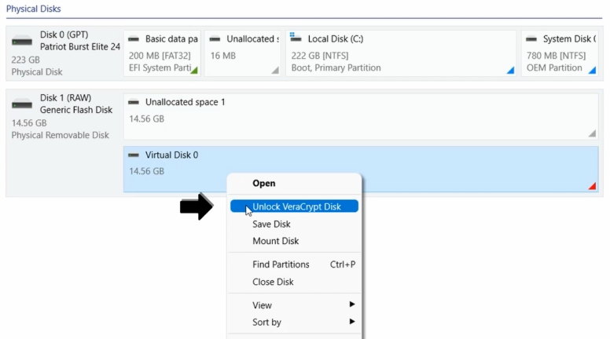

*Figure 15. The newly defined virtual disk is submitted for VeraCrypt unlocking.*


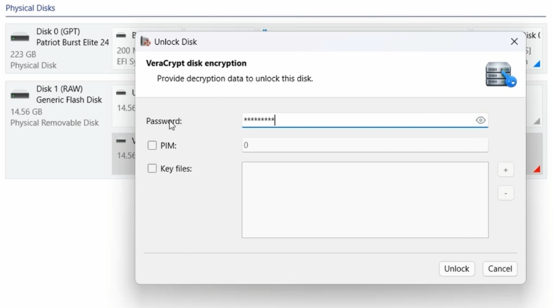

*Figure 16. The reconstructed encrypted partition is unlocked using its access credentials.*


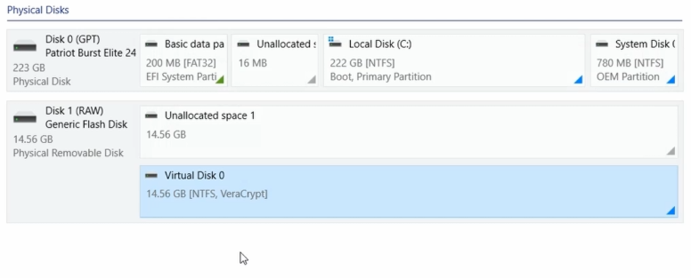

*Figure 17. The standard decrypted virtual volume is recognized as NTFS in the test UI.*


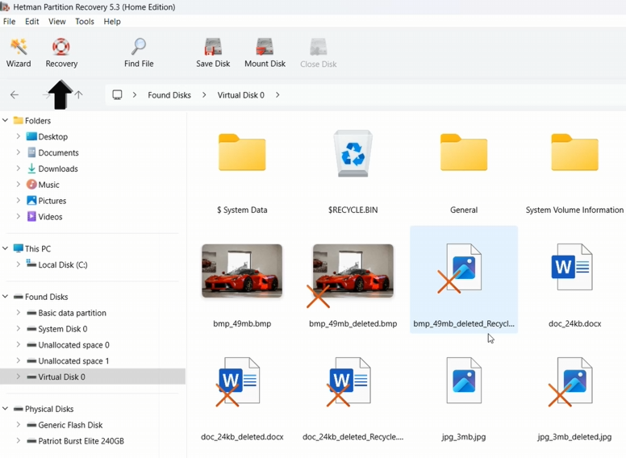

*Figure 18. The reconstructed standard volume exposes a directory tree with deletion-marked entries.*


### Unlock the hidden exFAT volume separately

A second virtual entry is selected for unlocking with the hidden-volume credentials. The corresponding result identifies **Virtual Disk 1** as **1,023.88 MB [exFAT, VeraCrypt]**. This is important evidence that the hidden-volume decryption and filesystem interpretation did not simply reuse the outer NTFS view.

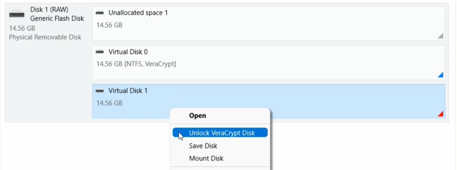

*Figure 19. A separate virtual-disk entry is unlocked with the hidden volume credentials.*


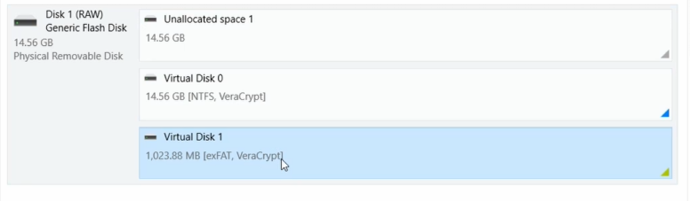

*Figure 20. The second unlocked volume is detected as a 1,023.88 MB exFAT VeraCrypt volume.*


## Results and evidence level

| Tested workflow | Decrypted filesystem identified | File entries visible | Exported files | Integrity-verified exports |
|---|---|---|---|---|
| File container imported as RAW disk | NTFS | Yes, including deletion markers | Not recorded | Not recorded |
| Existing encrypted USB standard volume | Supported; file browser visible | Yes, including deletion markers | Not recorded | Not recorded |
| Virtual reconstruction after partition-table loss, outer volume | NTFS, 14.56 GB shown | Yes, including deletion markers | Not recorded | Not recorded |
| Re-unlock with hidden-volume credentials | exFAT, 1,023.88 MB shown | The scan workflow is described; final individual files not independently verified | Not recorded | Not recorded |

**Interpretation:** A file marked as deleted in the application's result list is evidence of an enumerated file entry, not proof that its clusters remained intact, that it was exported successfully, or that its content hash matches the original file. No aggregate recovery rate is supported by this source.

## Limitations

- The test date, VeraCrypt version, complete creation parameters, encryption algorithm for each volume, KDF and volume-header details are not recorded.
- The screenshots show a Windows-based recovery workflow, not a test of VeraCrypt container recovery on other platforms.
- PIM and key-file support appears in the user interface, but each possible authentication combination was **not individually validated** by the supplied measurements.
- The presence of a separate hidden volume and its exFAT identification are demonstrated, but the source does not establish guaranteed recovery from all hidden-volume failure modes.
- No proof of successful export, application-open checks, file hashes or full dataset comparison is provided.
- The `diskpart clean` command is described in the script, but a console execution log and before/after sector-level diff are unavailable.
- The test does not establish recovery when a password or mandatory key file is lost, or when VeraCrypt volume headers are irreparably damaged.

## Conclusion

For the specific environments pictured here, Hetman Partition Recovery 5.3 displayed an encrypted VeraCrypt file container as an unlockable RAW disk, identified the decrypted NTFS content, and showed deletion-marked file entries. For the removable device, the interface also showed separate standard **NTFS** and hidden **exFAT** volume interpretations. After the partition table became unavailable, a **virtual** partition definition beginning at sector **2,048** permitted a subsequent VeraCrypt unlock and filesystem analysis.

The supported technical finding is **successful access to and enumeration of filesystem entries after unlocking or virtual reconstruction**, not a quantified or independently validated data-recovery success rate.
